# 4.3 视频生成与编辑技术路线
> 💡 **本章目标**：结合代表方法，理解视频生成与编辑中的能力复用、时空建模、条件控制及质量与效率取舍。第二章介绍通用原理，本章重点分析这些设计在具体模型中如何组合、解决什么问题，以及有哪些限制。
>
> 4.3.4—4.3.6分别围绕代表研究、开放模型和质量、控制与效率选取案例，分组依据有所不同。一个模型可能同时属于多个专题；本章按各案例重点解释的技术问题安排位置，不将它们视为互斥的路线或前后替代的阶段。

---

## 目录导航

**[4.3.1 视频生成任务：输入条件、任务边界与能力要求](#q-4-3-1)**
- [4.3.1.1 面试问题：按主要输入条件，视频生成任务有哪些常见类型？](#q-4-3-1-1)
- [4.3.1.2 面试问题：视频续写、关键帧条件生成、视频修复与视频编辑的任务边界如何划分？](#q-4-3-1-2)
- [4.3.1.3 面试问题：为什么接入一种输入条件，不等于模型真正具备对应的任务能力？](#q-4-3-1-3)

**[4.3.2 视频生成技术路线的分析方法与基本取舍](#q-4-3-2)**
- [4.3.2.1 面试问题：分析一条视频生成技术路线时，应该抓住哪些关键设计与取舍？](#q-4-3-2-1)
- [4.3.2.2 面试问题：图像模型视频化与原生时空建模的核心取舍是什么？](#q-4-3-2-2)

**[4.3.3 图像生成能力的视频化与运动定制：AnimateDiff、SVD 等代表方法](#q-4-3-3)**
- [4.3.3.1 面试问题：AnimateDiff 的 Motion Module 如何插入图像扩散模型？](#q-4-3-3-1)
- [4.3.3.2 面试问题：为什么 AnimateDiff 的运动模块可以迁移到个性化 T2I 模型？](#q-4-3-3-2)
- [4.3.3.3 面试问题：如何从参考视频中学习可复用的运动？MotionLoRA 与 MotionDirector 分别解决什么问题？](#q-4-3-3-3)
- [4.3.3.4 面试问题：AnimateDiff 与 SVD 在图像先验复用和视频训练上有何差异？](#q-4-3-3-4)

**[4.3.4 视频与音视频生成的代表研究：Sora、Veo 与 Movie Gen](#q-4-3-4)**
- [4.3.4.1 面试问题：Sora 如何将图像与不同尺寸的视频纳入统一的训练与生成框架？](#q-4-3-4-1)
- [4.3.4.2 面试问题：Sora 保留不同宽高比、分辨率和时长的数据有什么意义？可变尺寸训练带来哪些代价？](#q-4-3-4-2)
- [4.3.4.3 面试问题：如何理解 Sora 的“世界模拟器”说法？公开视频展示了哪些能力，又有哪些局限？](#q-4-3-4-3)
- [4.3.4.4 面试问题：Veo 3 的原生音视频生成如何实现？相比仅生成视频，新增了哪些建模与评估要求？](#q-4-3-4-4)
- [4.3.4.5 面试问题：Movie Gen 如何从视频生成基座扩展到个性化、视频编辑与音频生成？这些能力之间是什么关系？](#q-4-3-4-5)
- [4.3.4.6 面试问题：Movie Gen Video 如何结合时空压缩、Transformer 与并行训练，支持大规模视频生成？](#q-4-3-4-6)
- [4.3.4.7 面试问题：从 Sora、Veo 与 Movie Gen 的公开资料看，视频生成有哪些共同技术方向？哪些设计仍存在明显差异？](#q-4-3-4-7)

**[4.3.5 开放视频生成模型的代表设计与技术取舍](#q-4-3-5)**
- [4.3.5.1 面试问题：Open-Sora 2.0 如何通过模型复用与分阶段训练控制视频模型的训练成本？](#q-4-3-5-1)
- [4.3.5.2 面试问题：HunyuanVideo 如何处理文本条件，并通过双流到单流结构融合文本与视频？](#q-4-3-5-2)
- [4.3.5.3 面试问题：Wan2.2 A14B 为什么按噪声阶段划分专家？这种分工有哪些收益与代价？](#q-4-3-5-3)
- [4.3.5.4 面试问题：Step-Video 如何用深压缩表示配合大规模视频生成主干？有哪些取舍？](#q-4-3-5-4)
- [4.3.5.5 面试问题：CogVideoX 的 3D Causal VAE 与 Expert Transformer 如何配合？Expert 指什么？](#q-4-3-5-5)
- [4.3.5.6 面试问题：CogVideoX 为什么采用混合时长、Multi-Resolution Frame Pack 与渐进分辨率训练？](#q-4-3-5-6)
- [4.3.5.7 面试问题：MiniMax-H3 如何利用多模态参考生成音视频？开放的 H3-Base 与完整生成流程有什么区别？](#q-4-3-5-7)

**[4.3.6 视频生成的质量、控制与效率：代表模型案例](#q-4-3-6)**
- [4.3.6.1 面试问题：Seedance 1.0 如何通过后训练与推理加速，兼顾生成质量和效率？](#q-4-3-6-1)
- [4.3.6.2 面试问题：Kling-Omni 如何结合多模态指令理解、视频生成与超分辨率，支持参考生成和编辑？](#q-4-3-6-2)
- [4.3.6.3 面试问题：LTX-Video 如何通过高压缩表示与解码去噪的协同设计降低生成开销？](#q-4-3-6-3)

**[4.3.7 视频编辑技术路线：源视频利用、修改控制与跨帧一致性](#q-4-3-7)**
- [4.3.7.1 面试问题：基于生成模型的视频编辑有哪些主要思路？它们如何利用源视频？](#q-4-3-7-1)
- [4.3.7.2 面试问题：视频编辑如何同时满足目标修改、源内容保持与时间一致性？](#q-4-3-7-2)
- [4.3.7.3 面试问题：扩散式视频编辑如何利用反演、注意力控制、时空掩码与特征传播？](#q-4-3-7-3)
- [4.3.7.4 面试问题：VACE 如何通过统一条件表示支持多种视频生成与编辑任务？](#q-4-3-7-4)
- [4.3.7.5 面试问题：指定时间段的视频编辑，如何控制修改范围并保持其他内容？](#q-4-3-7-5)

**[总结](#q-4-3-summary)**

**[参考文献](#q-4-3-references)**

---

## <a id="q-4-3-1"></a>4.3.1 视频生成任务：输入条件、任务边界与能力要求

> 本节明确生成请求中的输入条件、目标与保持要求。第一章介绍生成、编辑与理解的基本区别；这里进一步区分参考生成、续写、关键帧生成与修复等具体任务。多任务模型的共享与组织方式见第六章。

### <a id="q-4-3-1-1"></a>4.3.1.1 面试问题：按主要输入条件，视频生成任务有哪些常见类型？

**难度评分：⭐⭐⭐ (3/5)  |  考察频率：⭐⭐⭐⭐⭐ (5/5)**

常见类型包括**文生视频（T2V）、图生视频（I2V）和视频到视频（V2V）**，分别以文本、图像和视频作为主要输入。同一个模型可以支持多类任务，实际请求也可以组合多种输入条件。

**1、三类常见输入任务**

表3-1概括了三类常见任务。

<p align="center">表3-1 T2V、I2V 与 V2V 的主要输入及生成要求</p>

| 类型 | 主要输入 | 模型需要生成或改变什么 | 重点要求 |
| --- | --- | --- | --- |
| 文生视频（Text-to-Video，T2V） | 文本描述 | 根据描述生成主体、场景、动作和镜头变化 | 符合文本要求，画面与运动连贯 |
| 图生视频（Image-to-Video，I2V） | 图像，可结合文本等条件 | 在给定视觉信息基础上生成时间变化和新内容 | 按任务要求保持参考外观、场景或起始画面 |
| 视频到视频（Video-to-Video，V2V） | 输入视频，可结合指令或其他条件 | 对视频进行转换、修改或生成相关内容 | 明确哪些内容需要保留、哪些允许改变 |

例如，同样生成“一只猫向前奔跑”：

- **T2V**：只提供文字，猫的具体外观、背景和运动由模型生成。
- **I2V**：提供猫的图像，要求模型参考其外观或以该图作为起始画面生成运动。
- **V2V**：提供已有的猫奔跑视频，再要求改变背景、风格或其他指定内容。

视频输入也可以用于续写或修复等任务。这些任务的名称有时会单独列出，因此不能仅凭“V2V”判断具体操作。

**2、图像条件的作用与其他控制输入**

图像条件需要区分两种常见作用：

- **首帧条件**：指定期望的起始画面，并生成后续变化；是否严格保持首帧，还要看模型和实现。
- **参考图条件**：提供主体、外观或场景信息，不一定指定它在视频中的时间位置。

提供首尾帧或多个关键帧时，还需说明它们对应的时间位置，具体边界见下一题。

此外，姿态、轨迹、音频等条件可以与文本、图像或视频组合使用。例如，人物参考图与语音共同驱动说话视频，既包含外观约束，也包含口型与音频同步要求。音频也可以成为主要输入，单独形成音频驱动视频生成任务。

**3、统一多模态生成与任务类型的关系**

统一多模态生成描述一个模型或一套模型体系对多种输入、输出和任务的支持。它可以覆盖 T2V、I2V、V2V，也可能支持音视频联合输出。描述具体能力时，仍需交代输入条件、任务目标和输出形式。

例如，Movie Gen 分别组织文生视频、人物个性化、视频编辑和音频生成能力，而不将它们合并为一种输入类型[1]。

> **面试速答**：常见任务有 T2V、I2V 和 V2V，分别以文本、图像和视频作为主要输入。它们描述任务接口，同一个模型可以支持多类任务。分析时还要说明输入内容的作用、需要保留和改变什么，以及是否包含音频等其他条件；统一多模态生成则描述多种能力如何共同组织。

### <a id="q-4-3-1-2"></a>4.3.1.2 面试问题：视频续写、关键帧条件生成、视频修复与视频编辑的任务边界如何划分？

**难度评分：⭐⭐⭐⭐ (4/5)  |  考察频率：⭐⭐⭐ (3/5)**

视频续写主要延长已有内容，关键帧条件生成连接指定画面，补全修复填补指定区域，视频编辑则按要求修改已有内容。它们的边界取决于生成目标和保持要求，也可能在同一任务中组合使用。

**1、四类任务的目标与保持要求**

表3-2概括了它们的典型目标。这里的“视频修复”主要指缺失或被指定区域的补全修复，不泛指所有视频质量增强任务。

<p align="center">表3-2 视频续写、关键帧条件生成、视频补全修复与视频编辑的主要区别</p>

| 任务 | 已有输入 | 主要生成或修改内容 | 重点要求 |
| --- | --- | --- | --- |
| 视频续写 | 一段已有视频 | 在已有片段之后生成新内容 | 衔接处自然，主体、场景和事件状态能够延续 |
| 关键帧条件生成 | 指定时间位置的首尾帧或多个关键帧 | 生成连接关键画面的中间过程 | 符合关键帧要求，中间变化连贯合理 |
| 视频补全修复 | 视频及缺失、损坏或指定补全区域 | 补全相应时空区域 | 与周围画面和跨帧运动衔接，尽量保持其他内容 |
| 视频编辑 | 源视频，以及修改指令或其他条件 | 改变指定对象、属性、背景、风格或动作等 | 完成目标修改，同时保持任务要求保留的内容 |

例如，对于“一只猫在草地上奔跑”的视频：

- **续写**：已有前几秒，继续生成猫接下来的动作。
- **关键帧条件生成**：给出猫在左侧的起始画面和在右侧的结束画面，生成中间的奔跑过程。
- **补全修复**：画面中有一块缺失区域，结合邻近画面和其他帧补全内容。
- **编辑**：将草地改为雪地，同时尽量保持猫的外观和原有动作。

**2、任务之间的交叉与区别**

**（1）关键帧条件生成不等于普通插帧。**

普通插帧通常在已有相邻帧之间增加画面，以提高时间采样密度；关键帧条件生成可以面对间隔较长、变化较大的画面，需要生成更完整的动作或场景过渡。

关键帧表达的是目标约束，输出是否严格保持这些画面，还取决于模型与实现方式。

**（2）补全修复与编辑可以重叠。**

补全修复主要根据上下文填补指定区域；编辑强调按照目标要求改变内容。但同一个操作可能同时具有这两种性质。

例如，“移除视频中的路人”属于编辑任务，也可以通过标记路人区域、补全其后的背景来实现。

*完成修改与保持源内容之间的取舍，见[4.3.7.2](#q-4-3-7-2)。*

**（3）续写与关键帧条件也可以组合。**

已有视频提供起始上下文，再给出期望的结束画面，就同时包含延续已有内容和满足结束画面的要求。

> **面试速答**：续写延长已有视频，关键帧条件生成连接指定画面，补全修复填补指定时空区域，编辑按要求改变已有内容。它们的区别主要在生成目标和保持要求，也可以交叉组合，例如对象移除既是编辑，也可通过补全实现。

### <a id="q-4-3-1-3"></a>4.3.1.3 面试问题：为什么接入一种输入条件，不等于模型真正具备对应的任务能力？

**难度评分：⭐⭐⭐⭐ (4/5)  |  考察频率：⭐⭐⭐ (3/5)**

**条件信息能够进入模型计算，并不意味着模型会有效利用它。只有生成结果能够响应条件，并满足相应的内容保持和时间连续性要求，才能说明模型具备对应的任务能力。**

例如，模型接口允许输入人物参考图，不代表生成的人物就能在转头、遮挡和姿态变化后保持相同身份。需要验证参考信息是否在整个视频中得到有效利用。

**1、任务能力形成的条件**

**（1）条件表示保留必要信息。**

输入经过编码后，部分信息可能丢失。例如，参考图特征能够表达“一个穿红衣服的人”，但未必保留足够的面部细节，支持后续身份保持。

**（2）注入路径有效影响生成。**

条件需要通过适当的注意力、特征调制、拼接或控制分支影响生成。即使张量维度正确、计算能够运行，模型仍可能较少利用该条件，或将其作用到错误的时间和空间位置。

例如，区域掩码已经输入，但编辑仍影响整幅画面，说明“能够传入掩码”并不等于“能够准确限制修改范围”。

**（3）训练建立条件与输出的对应关系。**

新增条件接口通常需要训练或适配，让模型学会利用条件。

例如，主体保持需要模型在外观保持与姿态变化之间取得协调；音频驱动需要学习声音与口型的时间对应。仅具备图像输入能力，不能自动获得这些任务能力。

**2、条件控制能力的验证**

可以固定一组随机种子和其他条件，比较原条件、替换条件，以及在模型支持时移除条件后的结果：

- **目标是否按要求变化。** 例如，改变姿态条件后，人物动作是否相应改变。
- **要求保留的内容是否稳定。** 例如，局部编辑后，非编辑区域是否尽量保持。
- **视频中的响应是否持续、连贯。** 例如，人物身份是否只在首帧相似，随后逐渐漂移；口型是否只在部分片段与语音同步。

判断时需要考虑合理的连带变化。例如，改变动作可能同时改变遮挡和阴影，不能将所有非目标变化都视为控制失败。

若改变条件后结果几乎不变，应检查条件表示、注入路径及条件冲突，并通过多个样本和随机种子，结合任务指标与人工观察判断，不能仅凭一次结果确定原因。

> **面试速答**：接口支持某种条件，不代表模型具备对应任务能力。还需要条件表示保留必要信息、注入路径能够有效影响生成，以及训练建立条件与目标的联系。验证时应替换条件，并在模型支持时移除条件，检查目标是否按要求变化、应保留内容是否稳定，以及这种控制能否在视频中持续生效。

## <a id="q-4-3-2"></a>4.3.2 视频生成技术路线的分析方法与基本取舍

> 第二章介绍了视频表示、生成目标、主干和条件注入。本节说明如何比较这些设计的组合，并讨论复用图像模型与围绕视频整体设计之间的取舍，为后续案例分析提供依据。

### <a id="q-4-3-2-1"></a>4.3.2.1 面试问题：分析一条视频生成技术路线时，应该抓住哪些关键设计与取舍？

**难度评分：⭐⭐⭐⭐ (4/5)  |  考察频率：⭐⭐⭐⭐ (4/5)**

视频生成技术路线的差异，主要体现在视频表示、时空主干、条件控制、训练方案和推理过程上。分析时，需要结合目标任务，说明这些设计为什么采用、改善了什么能力，以及增加了哪些成本或限制。

**1、视频表示与压缩**

视频可以直接在像素空间中建模，也可以先编码为连续潜变量或离散 token。采用压缩表示时，需要关注空间和时间压缩程度，以及重建后的细节和运动是否得到保留。

更紧凑的表示通常能减少主干计算，但压缩过强可能损伤文字、小物体和短暂动作。因此，需要同时比较计算收益与重建损失。

**2、主干结构与跨帧交互**

主干可以采用 U-Net、DiT 或其他结构，需要进一步分析不同时间、不同空间位置之间的信息交互方式。

保留图像主干、增加时间模块，可以继承已有的空间处理能力；但新增模块需要适配原有特征和网络接口。扩大时空交互范围，可以让更多位置直接交换信息，同时也可能增加计算和显存开销。

重点是确定跨帧信息传递的范围，以及它如何支持目标任务，不能仅凭“使用 Transformer”判断运动建模能力。

**3、条件输入与控制范围**

条件控制需要关注文本、参考图、源视频、姿态或轨迹等信息的编码与注入方式，以及模型如何表达需要保留和允许改变的内容。

例如，参考图用于提供主体外观，与将图像作为严格保持的首帧，对条件接口和保持机制的要求不同。

**4、预训练与任务适配**

训练路线包括预训练权重的来源、参与更新的模块、训练数据，以及视频预训练和任务适配的阶段安排。

冻结图像主干、只训练新增时间模块，可以减少需要更新的参数及相关训练开销，但限制了原有特征的调整；联合训练整个网络，可调整的参数范围更大，通常也需要更多训练资源。

数据的运动分布、片段长度、帧率及标注质量，同样会影响模型能够学到的能力。

**5、生成目标与推理方式**

对于本节讨论的扩散与流模型，需要明确模型预测的是噪声、干净表示还是速度，以及推理时怎样利用预测更新状态。还应区分整段生成与分段延续，分析后者如何保持片段之间的衔接。

还要结合采样步数、条件引导和编解码成本，判断最终的质量、显存及延迟。相同主干可以配合不同训练目标；相同步数，也不一定对应相同计算成本。

图3-1展示了视频表示、条件输入、生成主干和解码之间的关系，可辅助理解这些设计在流程中的位置。

<div align="center">
  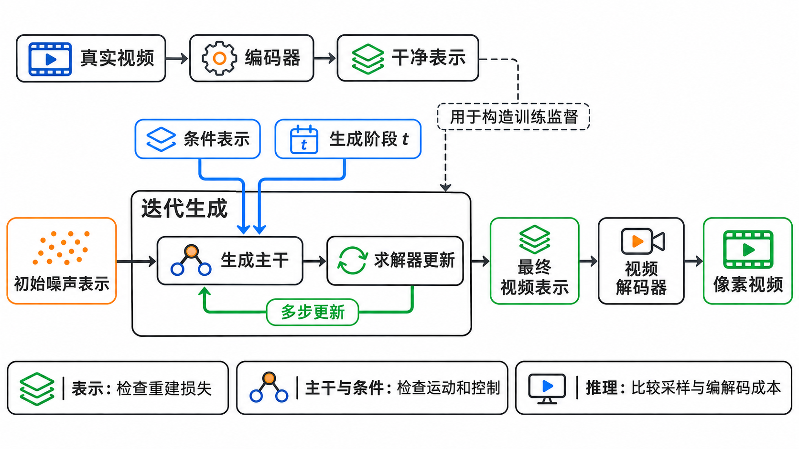
  <p>图3-1 视频生成路线中的表示、条件、生成主干与解码</p>
</div>

对设计收益的判断，应结合明确的评测任务和运行条件。展示效果可以说明部分能力，但不足以证明具体设计的贡献；公开资料没有说明的实现细节，也不宜自行补全。

> **面试速答**：分析视频生成技术路线时，需要结合目标任务，考察视频表示、时空主干、条件控制、训练方式和推理过程。重点说明这些设计如何影响生成能力、计算成本和适用范围，并结合实际评测判断其收益与局限。

### <a id="q-4-3-2-2"></a>4.3.2.2 面试问题：图像模型视频化与原生时空建模的核心取舍是什么？

**难度评分：⭐⭐⭐⭐⭐ (5/5)  |  考察频率：⭐⭐⭐⭐ (4/5)**

**核心取舍是保留多少已有图像能力、对表示和网络做多大改造，以及投入多少视频数据与训练资源。** 图像模型视频化侧重复用已有模型，再补充时间处理；原生时空建模则更强调围绕视频需求共同设计表示、网络和训练。

**1、两种思路怎样实现？**

**图像模型视频化**以预训练图像模型为基础，保留空间处理层，加入时间卷积或时间注意力，再用视频数据训练。这样可以复用模型已有的外观、纹理、构图和文本对应能力，即**图像先验**。

例如，AnimateDiff训练运动模块，再将其接入同一图像基座的兼容个性化模型，让已有外观生成能力与运动生成结合[2]。

**原生时空建模**围绕视频同时安排压缩表示、跨帧交互和训练。例如，通过视频编码器压缩连续帧，由时空网络处理不同时间位置的信息，再用视频片段学习动作与状态变化。

*这里的“原生”强调围绕视频整体设计，不要求全部参数从零训练，也可以复用图像数据与预训练权重。*

**2、核心取舍体现在哪里？**

<p align="center">表3-3 图像模型视频化与原生时空建模的设计取舍</p>

| 比较维度 | 侧重图像模型视频化 | 侧重原生时空建模 |
| --- | --- | --- |
| 已有能力复用 | 尽量保留图像主干、个性化能力和配套模块 | 按视频需求决定哪些部分保留、调整或重新设计 |
| 结构改动 | 通常在已有空间层中增加时间模块，受原有接口约束 | 可以共同设计视频压缩、空间处理与跨帧交互 |
| 训练投入 | 冻结部分主干、主要训练新增模块时，可减少更新参数及相关开销 | 联合调整更多模块时，需要相应的数据、训练与验证投入 |
| 主要取舍 | 保持原模型兼容性，同时补足时间处理能力 | 获得更大的设计空间，同时承担模块适配与训练成本 |

增加时间模块便于复用，但其交互范围和容量可能限制运动建模；扩大整体改造范围可以调整这些限制，却不保证效果更好，仍需实际训练与评测。

**3、实际如何选择与结合？**

- **已有成熟图像模型，需要保留风格或个性化能力时，**可以先评估增加时间模块的方案，并检查兼容性与运动效果。
- **原有结构无法满足目标运动或时间跨度时，**再考虑扩大联合训练范围，或调整视频表示与主干，同时评估数据需求和计算成本。

两种思路可以结合。例如，SVD先进行图像预训练，再经过视频预训练和高质量视频微调，利用已有图像能力逐步学习视频生成[3]。

> **面试速答**：图像模型视频化侧重复用已有外观生成能力，通过新增时间结构学习跨帧关系；原生时空建模更强调围绕视频整体安排表示、网络和训练。核心取舍是保留多少已有能力、允许多大改造，以及能够投入多少视频数据和训练资源。两者可以结合，实际能力应根据结构、训练和评测判断。

## <a id="q-4-3-3"></a>4.3.3 图像生成能力的视频化与运动定制：AnimateDiff、SVD 等代表方法

> 本节围绕已有生成能力如何复用与适配展开：AnimateDiff 为兼容图像模型学习可复用的时间模块，SVD 通过图像预训练、视频预训练和高质量微调形成视频模型；MotionLoRA 与 MotionDirector 则研究已有视频能力如何适配特定运动。这些案例分别解释参数更新范围、迁移条件、外观与运动耦合，以及数据和训练阶段的作用，不表示它们构成前后替代关系。

### <a id="q-4-3-3-1"></a>4.3.3.1 面试问题：AnimateDiff 的 Motion Module 如何插入图像扩散模型？

**难度评分：⭐⭐⭐⭐ (4/5)  |  考察频率：⭐⭐⭐⭐⭐ (5/5)**

AnimateDiff 在预训练图像扩散模型的 U-Net 中插入**运动模块（Motion Module）**，让原本逐帧处理的空间特征能够沿时间维交换信息。VAE、文本编码器和原有空间层继续复用，新增模块负责补充跨帧联系。

**1、运动模块怎样处理空间特征？**

AnimateDiff 在 U-Net 的多个分辨率层插入时间 Transformer。原有空间层逐帧处理特征，运动模块将同一空间坐标的多帧特征组成时间序列，通过自注意力交换信息，并用时间位置编码区分帧序；处理后恢复视频特征形状，继续传入后续层。

*通用的维度组织与模块接入方式，参见[4.2.5.1](02_AI视频生成原理与模型架构.md#q-4-2-5-1)。*同一坐标在不同帧中不一定属于同一对象，运动仍需要空间层与时间模块配合建模。

图3-2展示了运动模块的插入位置及特征流。

<div align="center">
  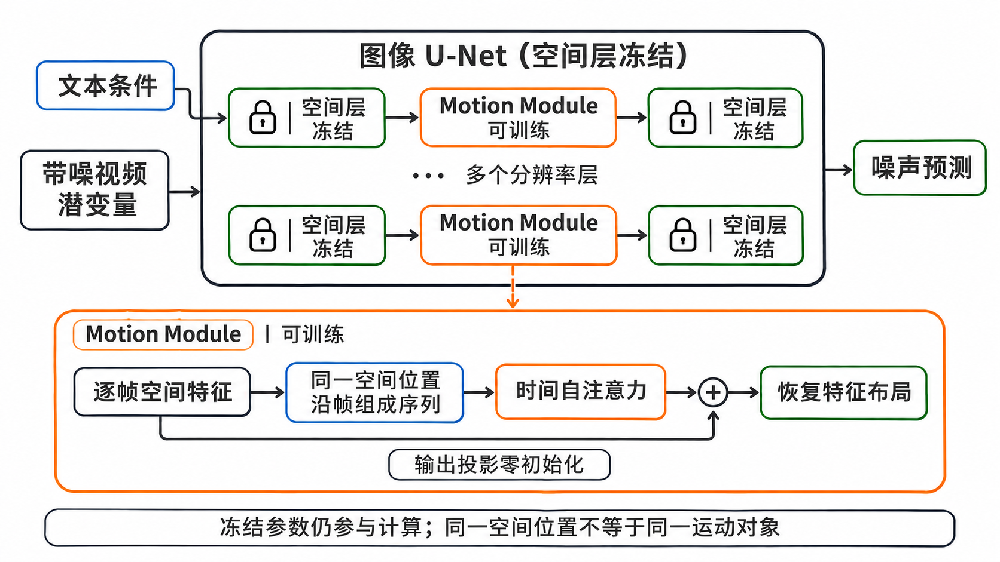
  <p>图3-2 AnimateDiff 的空间层与可训练时间模块</p>
</div>

**2、怎样接入预训练模型并进行训练？**

运动模块采用残差连接，将时间处理分支的输出加回输入特征。论文将该分支的输出投影层零初始化，使新增模块在训练开始时近似保持输入不变，减少随机初始化对原有空间特征的干扰。

在运动模块训练阶段，原有图像模型参数保持冻结，使用视频数据更新运动模块。模型根据带噪的视频潜变量和文本条件预测噪声，通过视频去噪训练学习跨帧变化；它不需要显式输出光流。

“冻结主干”指参数不更新，主干仍参与计算。论文中的域适配器和可选 MotionLoRA 属于其他训练阶段，不应与运动模块训练混为一谈[2]。

> **面试速答**：AnimateDiff 在图像 U-Net 的多个分辨率层插入运动模块。空间层逐帧处理特征，运动模块将同一空间坐标的多帧特征组成时间序列，通过时间注意力建立联系，再恢复原形状。模块采用残差连接和零初始化输出投影，训练时冻结原有图像参数，利用视频去噪目标学习新增的时间能力。

### <a id="q-4-3-3-2"></a>4.3.3.2 面试问题：为什么 AnimateDiff 的运动模块可以迁移到个性化 T2I 模型？

**难度评分：⭐⭐⭐⭐ (4/5)  |  考察频率：⭐⭐⭐⭐ (4/5)**

AnimateDiff 的迁移主要面向**来自同一图像生成基座、保留兼容 U-Net 结构的个性化模型**。这些模型虽改变了主体或风格的生成倾向，但保留了兼容的插入位置与特征接口，因此可复用同一运动模块，无须逐个重新训练[2]。

**1、为什么可以迁移？**

同一基座的个性化模型通常保留相同的层级和通道配置，运动模块能够在对应位置接收特征，并返回相同形状的结果。外观适配与运动模块也使用不同的参数路径，便于将已有个性化能力与视频训练得到的跨帧处理组合起来。

例如，一个保留原有 U-Net 结构的卡通风格模型，可以接入为该基座训练的运动模块。*模块插入与训练过程见[4.3.3.1](#q-4-3-3-1)。*

**2、接口兼容为什么还不够？**

运动模块处理的是图像主干输出的特征。即使张量形状匹配，个性化训练也可能改变特征分布，使原有运动处理不再同样有效。主体形态、目标风格和运动训练数据的差异，也会影响结果。

因此，接入后还需检查：

- **个性化是否保留：** 主体身份、风格与画面细节是否出现明显退化。
- **运动是否有效：** 是否完成目标动作，以及遮挡、视角变化和较长片段中是否仍然连贯。

结构与版本匹配后，仍需通过生成对照验证效果，不能仅凭模型同源、微调方式或权重合并次数判断成败。

> **面试速答**：同一图像基座的个性化模型通常保留兼容的 U-Net 层级与特征接口，AnimateDiff 因此可以复用同一个运动模块。模块仍依赖空间特征，外观与运动并非完全独立；接入后需要检查个性化保持与目标运动，不能将形状兼容当作效果保证。

### <a id="q-4-3-3-3"></a>4.3.3.3 面试问题：如何从参考视频中学习可复用的运动？MotionLoRA 与 MotionDirector 分别解决什么问题？

**难度评分：⭐⭐⭐⭐ (4/5)  |  考察频率：⭐⭐⭐⭐ (4/5)**

运动定制希望从参考视频中学习某种运动模式，再用于新的主体或场景。难点是参考视频同时包含人物、背景和动作，适配时可能将这些信息一起学入。**MotionLoRA 侧重在已有运动模块上轻量适配新模式；MotionDirector 则进一步减少参考外观对运动学习的干扰。**

**1、MotionLoRA：在已有运动模块上适配新运动。**

AnimateDiff 的运动模块已经通过视频训练获得一般的跨帧处理能力。MotionLoRA 在其时间自注意力层中加入可训练的低秩权重增量，冻结原有参数，再用少量参考视频进行适配。

这样，无须重新训练整个运动模块，就能学习特定运动模式。论文主要展示了镜头推进、拉远、平移和旋转等效果，也展示了组合不同 MotionLoRA 权重的用法[2]。

低秩适配减少了训练参数和权重存储开销，但不保证任意运动组合都能稳定实现。

**2、MotionDirector：减少运动学习对参考外观的依赖。**

例如，希望学习“挥手”，再换成另一位人物和新的背景；如果输出仍反复出现参考人物的服装或原背景，就可能存在外观混入。MotionDirector 针对这一问题调整学习路径与训练目标。

MotionDirector 在预训练视频扩散模型上使用两条学习路径：

- **空间 LoRA**主要拟合参考视频的外观；
- **时间 LoRA**主要学习跨帧运动变化。

它还设计了减少外观偏差的时间损失，降低外观信息对运动训练目标的干扰。推理时，可以加载学到的时间 LoRA，让基础模型在不同外观条件下生成定制运动[4]。

这种分工旨在改善运动复用，并不意味着外观与运动已经完全独立。

**3、两者的区别应怎样理解？**

MotionLoRA 强调运动模式的轻量适配；MotionDirector 则通过空间、时间 LoRA 分工及相应损失，改善运动在不同外观下的复用。

两者都需要检查目标运动是否学到、提示词指定的主体与场景是否保留，以及结果是否连续。少量参数降低了适配开销，但运动复杂度、参考数据和基础模型能力仍会限制最终效果。

> **面试速答**：MotionLoRA 在 AnimateDiff 的时间注意力层上训练低秩增量，以较小开销适配新的运动模式。MotionDirector 使用空间和时间 LoRA 分别学习外观与运动，并通过减少外观偏差的时间损失，改善运动在不同主体和场景中的复用。两者都属于运动定制，分别更强调适配效率与外观、运动分离的训练设计。

### <a id="q-4-3-3-4"></a>4.3.3.4 面试问题：AnimateDiff 与 SVD 在图像先验复用和视频训练上有何差异？

**难度评分：⭐⭐⭐⭐ (4/5)  |  考察频率：⭐⭐⭐⭐⭐ (5/5)**

两者都利用预训练图像扩散模型，并增加时间处理结构。**AnimateDiff 侧重保留图像主干，学习可接入兼容模型的运动模块；SVD 则通过分阶段训练，让空间层与时间层共同适应视频数据。**

*这里的SVD指Stable Video Diffusion论文中的整体训练路线，不仅指已发布的图生视频权重。*

**1、图像能力的复用方式有什么不同？**

<p align="center">表3-4 AnimateDiff 与 SVD 的图像能力复用及视频训练差异</p>

| 比较维度 | AnimateDiff | SVD论文路线 |
| --- | --- | --- |
| 图像能力的利用 | 冻结图像主干，训练新增运动模块 | 用图像预训练初始化，视频训练时更新空间层与时间层 |
| 训练组织重点 | 学习可迁移运动模块，并可进一步训练MotionLoRA | 图像预训练、视频预训练、高质量视频微调 |
| 数据处理重点 | 学习跨帧变化，减少视频外观分布对复用的干扰 | 通过视频筛选、标注和分阶段训练改善生成 |
| 训练结果的复用 | 将运动模块接入兼容的个性化图像模型 | 在视频模型基础上继续适配任务 |

表中AnimateDiff的“冻结图像主干”，指训练运动模块时不更新原有图像模型参数[2]；SVD的视频训练则同时更新空间层与时间层[3]。

*AnimateDiff如何接入运动模块，以及哪些个性化图像模型可以复用该模块，见[4.3.3.1](#q-4-3-3-1)和[4.3.3.2](#q-4-3-3-2)。*

**2、SVD为什么采用分阶段训练？**

三个阶段分别承担不同作用：

- **图像预训练：** 提供外观与文本对应的基础，复用已有空间生成能力。
- **视频预训练：** 在较大规模视频上学习运动与跨帧关系，通过镜头切分、描述生成和筛选减少不合适样本的干扰。
- **高质量视频微调：** 在较小的高质量视频集上，以更高分辨率继续训练，改善输出质量。

论文比较了跳过视频预训练、使用未筛选视频及筛选视频预训练后的微调结果。在论文设定下，前期数据筛选带来的收益，在后续高质量视频微调后仍然保留。这说明，仅在最后阶段使用高质量视频微调，并不能保证弥补前期视频学习或数据处理的不足[3]。

论文还展示了图生视频、镜头运动和多视角适配，但这些能力需要相应训练，并非一个基座权重自动具备[3]。

**3、怎样根据复用需求选择？**

为多个同源个性化图像模型增加运动，可以优先评估AnimateDiff，并检查结构兼容性与迁移效果；围绕视频基座继续适配任务，则可以评估SVD路线。

训练运动模块、完整视频基座和适配现成权重的投入不同，不能只按方法名称比较成本。

> **面试速答**：AnimateDiff 在运动模块训练时冻结图像主干，重点获得可接入同源个性化模型的时间模块；SVD 利用图像预训练初始化，通过视频预训练和高质量微调，使空间与时间处理共同适应视频数据。前者侧重运动模块复用，后者侧重视频模型及其后续适配，成本和效果需要结合具体训练范围判断。

## <a id="q-4-3-4"></a>4.3.4 视频与音视频生成的代表研究：Sora、Veo 与 Movie Gen

> 本节选取 Sora、Veo 与 Movie Gen 的公开研究，比较可变尺寸视觉表示、音视频联合生成、视频基座适配和规模化训练。它们承担不同的案例角色，并不构成同一套架构，也不代表始终领先的产品名单。分析以对应版本的论文和报告为依据：Sora 采用2024年技术报告，Veo 的联合生成采用 Veo 3 技术报告，Movie Gen 采用其模型家族论文。各题分别讨论代表设计及能力边界，不将功能展示直接当作内部实现的证据。

### <a id="q-4-3-4-1"></a>4.3.4.1 面试问题：Sora 如何将图像与不同尺寸的视频纳入统一的训练与生成框架？

**难度评分：⭐⭐⭐⭐ (4/5)  |  考察频率：⭐⭐⭐⭐⭐ (5/5)**

以下讨论基于 OpenAI 于 2024 年发布的 Sora 技术报告。其核心做法是：**将图像和视频转换为共同的视觉 token 表示，再由同一个扩散 Transformer（Diffusion Transformer，DiT）学习生成。**

**1、用时空 patch 表示图像和视频**

Sora 先通过视觉压缩网络，将视频编码为在时间和空间上经过压缩的潜变量，再从中提取时空 patch（spacetime patches），作为 Transformer 处理的 token。一个时空 patch 对应潜变量中一段时间、一块空间区域的数据。

图像可以视为只有一帧的视频，也采用这套表示。这样，图像与视频都能转换为同一种 token 序列；分辨率、宽高比和时长不同，序列的长度与对应的时空布局也可以不同。

这里需要区分压缩与切块：压缩网络负责得到更紧凑的视觉表示，切块负责组织 Transformer 的输入，不能将 patch 变大直接等同于压缩损失增加。

*关于潜空间压缩的作用，参见[4.2.2.1](02_AI视频生成原理与模型架构.md#q-4-2-2-1)；关于切块、token 化及输出还原，参见[4.2.4.2](02_AI视频生成原理与模型架构.md#q-4-2-4-2)。*

这些题目介绍通用架构原理，不代表 Sora 已公开确认采用其中列举的具体 VAE 实现。

**2、用共同的生成主干学习不同视觉数据**

转换为共同表示后，图像和视频可以参与同一个扩散 Transformer 的训练。模型接收带噪的时空 patch 和文本等条件，学习预测对应的干净 patch[5]。

生成时，按照目标时空尺寸组织噪声 patch，经多步去噪得到生成的潜变量，再由解码器还原为图像或视频。同一主干因此可以生成不同尺寸的内容。

**3、这条路线的意义与边界**

这套设计让图像、视频和不同尺寸的视觉数据能够共享表示与生成主干，支持联合训练，也为灵活选择输出尺寸提供了基础。*保留原始宽高比的收益，以及可变尺寸训练的数据组织问题，参见[4.3.4.2](#q-4-3-4-2)。*

共同表示不保证不同数据带来同等训练收益，也不意味着自动获得所有任务能力；具体任务仍需相应的条件处理和训练。报告没有披露完整模型与实现细节，因此不能据此断定 Sora 采用了某种具体的组批、注意力或并行方案。

> **面试速答**：Sora 将图像视为单帧视频，通过视觉压缩和时空切块，把图像与不同尺寸的视频转换为共同的 token 表示，再用同一个扩散 Transformer 学习生成。不同样本可以有不同的 token 数和时空布局；生成时按目标尺寸组织噪声 patch，逐步去噪并解码。这使图像与视频能够联合训练，并由同一模型生成不同尺寸的内容。

### <a id="q-4-3-4-2"></a>4.3.4.2 面试问题：Sora 保留不同宽高比、分辨率和时长的数据有什么意义？可变尺寸训练带来哪些代价？

**难度评分：⭐⭐⭐⭐ (4/5)  |  考察频率：⭐⭐⭐⭐ (4/5)**

以下基于 OpenAI 于2024年发布的 Sora 技术报告，讨论保留尺寸差异的收益与训练代价。

**1、减少裁剪损失，覆盖不同输出需求**

将横屏、竖屏视频统一裁成正方形，可能截掉人物、物体或交互区域，破坏构图。Sora 报告中的对比表明，保留原始宽高比训练，有助于改善取景与构图，减少主体只呈现一部分的情况。

可变尺寸表示还使同一模型能够生成不同分辨率、宽高比和时长的内容，而不只围绕一种固定规格训练和输出。“原始尺寸训练”不意味着完全不做预处理，报告并未披露完整的数据处理流程[5]。

**2、样本的计算量与训练贡献不再相同**

不同时空尺寸会形成不同数量的 token，使每个样本的显存、计算量和处理时间存在差异。例如，长视频或高分辨率视频通常比短视频或低分辨率视频占用更多资源；固定每批样本数，不能保证每批开销接近，多卡之间也可能出现等待。

同时，需要检查不同时长与尺寸的采样比例，以及损失如何归一化。按全部 token 平均损失，与先对每个样本求平均，会使长短样本对训练产生不同影响。

尺寸分桶、批量安排与负载均衡是处理这些问题的通用工程方法，不能直接当作 Sora 已公开的实现。*具体组批方法见[4.5.2.3](05_视频生成训练与工程优化.md#q-4-5-2-3)。*

> **面试速答**：保留不同宽高比有助于减少裁剪对内容与构图的破坏，可变分辨率和时长让同一模型覆盖更多输出需求。代价是样本的 token 数、计算量与处理时间不同，需要协调组批、设备负载及训练权重。通用工程方案与 Sora 已披露的设计应分别说明。

### <a id="q-4-3-4-3"></a>4.3.4.3 面试问题：如何理解 Sora 的“世界模拟器”说法？公开视频展示了哪些能力，又有哪些局限？

**难度评分：⭐⭐⭐⭐ (4/5)  |  考察频率：⭐⭐⭐⭐ (4/5)**

2024年 Sora 技术报告将规模化视频生成视为通向世界模拟器的一条可能路径。**理解这一判断，需要区分已展示的输出表现、能力是否稳定，以及能否据此解释模型内部机制。**

**1、公开样例提供了什么证据？**

视频既包含外观，也包含物体移动、交互和场景状态的变化。Sora 报告展示了一定的三维一致性、遮挡后对象保持，以及画笔留下笔迹等状态变化。这些现象为模型能够学习部分世界动态规律提供了初步证据[5]。

但报告也列出了玻璃破碎、进食后状态变化和长时间一致性等方面的错误。个别成功样例不能说明这些能力在不同场景中都可靠；输出正确或错误，也不足以直接确定内部是否存在某种物体状态表示或因果机制。

**2、怎样判断能否用于模拟或决策？**

应根据用途重复测试：改变初始位置、运动方向或支撑条件，观察后续变化是否合理响应；延长时间或加入遮挡，检查状态是否持续保持。如果用于控制或规划，还需验证连续动作下的预测与误差影响。这些是进一步的验证要求，不能当作该报告已经证明的能力。

*几何、物理与事件过程的具体评价维度，参见[4.1.7.2](01_AI视频基础概念.md#q-4-1-7-2)。*

> **面试速答**：Sora 的“世界模拟器”说法提出了规模化视频生成可能学习世界动态的研究方向。样例展示了部分空间、对象与状态一致性，也暴露出物理和长时间一致性错误。应通过明确条件下的重复测试判断能力范围，公开视频尚不足以证明可靠的通用物理模拟或决策能力。

### <a id="q-4-3-4-4"></a>4.3.4.4 面试问题：Veo 3 的原生音视频生成如何实现？相比仅生成视频，新增了哪些建模与评估要求？

**难度评分：⭐⭐⭐⭐ (4/5)  |  考察频率：⭐⭐⭐ (3/5)**

**Veo 3 将声音纳入生成过程，目标不仅是得到清晰的视频和音频，还要让两者描述同一个事件，并在时间上协调。**

**1、原生音视频生成是什么意思？**

在 Veo 3 中，模型可以根据提示生成包含环境声、音效或对白的视频，声音是生成能力的一部分，用户不必另外制作和添加音轨[6]。

根据技术报告，音频与视频分别通过自编码器转换为压缩潜变量：音频表示随时间变化，视频表示同时包含时间和空间维度。随后，在两类潜变量上联合进行扩散，使用基于 Transformer 的网络学习去噪[7]。

这说明音频与视频进入了共同的生成建模过程。不过，报告没有完整披露两类表示如何交互，不能进一步断言它们采用相同的 tokenizer、特定注意力结构或某种对齐损失。

**2、相比仅生成视频，新增了哪些要求？**

**（1）声音与画面需要表达一致的内容。**

声音应与主体、动作和场景相符。例如，玻璃杯落地时，声音应符合杯子的材质和碰撞事件；背景环境声也应与场景协调。

**（2）声画事件需要在时间上对应。**

碰撞声应与接触时刻协调，脚步声应与落脚节奏对应；人物对白还涉及说话者、语音内容与口型的匹配。视频和音频分别听起来、看起来合理，组合后仍可能出现错位。

**（3）生成过程需要兼顾两种模态的质量。**

模型既要保持画面与运动连贯，也要生成清晰、合理的声音，并满足跨模态关系。联合生成提供了协调声画的建模条件，但不会自动保证同步，也不能据此断言它在所有任务上都优于分阶段生成。

**3、怎样评估生成结果？**

可以从三个方面检查：

- **视频本身：** 主体、运动、接触和状态变化是否连贯。
- **音频本身：** 语音是否清晰、内容是否符合要求，环境声与音效是否合理。
- **声画关系：** 声音是否对应正确的主体和事件，发生时刻、持续时间与节奏是否匹配。

例如，检查“杯子掉落并破碎”时，应观察下落、接触和破碎过程，判断声音是否符合事件、碰撞声是否与落地时刻对应。

*物理合理性与因果连续性的评价维度，参见[4.1.7.2](01_AI视频基础概念.md#q-4-1-7-2)。*

> **面试速答**：Veo 3 将音频和视频分别压缩为潜变量，再通过基于 Transformer 的去噪网络进行联合扩散建模。相比仅生成视频，它还需要让声音的内容、来源与发生时间符合画面事件。评估时应分别检查视频质量、音频质量和声画对应关系，不能把联合生成等同于已经实现可靠同步。

### <a id="q-4-3-4-5"></a>4.3.4.5 面试问题：Movie Gen 如何从视频生成基座扩展到个性化、视频编辑与音频生成？这些能力之间是什么关系？

**难度评分：⭐⭐⭐ (3/5)  |  考察频率：⭐⭐⭐ (3/5)**

Movie Gen 采用两种方式扩展媒体生成能力：**在视频基座上进一步训练，得到个性化与编辑模型；另外训练音频模型，根据视频与文本等条件生成声音。** 因此，这些能力之间既有预训练能力的复用，也有不同模型之间的配合。

以下讨论基于《Movie Gen: A Cast of Media Foundation Models》论文。

**1、视频基座如何支持个性化与编辑？**

Movie Gen Video 根据文本生成图像或视频，通过预训练学习视觉内容与动态过程的生成能力。在此基础上，论文进一步训练了两类任务模型。

**（1）个性化：增加人物参考，学习保持身份。**

Personalized Movie Gen Video 结合人物参考图与文本生成视频。例如，参考图指定“是谁”，文本指定人物在什么场景中做什么。模型需要在动作、视角和场景变化中保持参考人物的身份特征。

它复用了视频基座的生成能力，但还需要专门的图像条件处理与训练，让模型学会利用人物参考。仅在提示词中增加人物描述，并不能替代这种适配。

**（2）编辑：增加源视频与指令，学习修改和保持。**

Movie Gen Edit 通过专门的后训练，学习根据源视频和编辑指令修改内容。它还需尽量保持人物、背景或运动中不需要修改的部分。

例如，将视频中人物的服装改成雨衣，需要完成服装变化，同时避免无故改变人物身份和原有动作。这要求模型学习源视频、编辑指令与目标结果之间的关系，不能仅靠文生视频训练获得保证。

两类适配都复用了视频基座，但新增条件、训练数据和任务要求不同；它们是由共同基座发展出的模型，不代表同一套参数自动完成所有任务[1]。

图3-3展示了视频基座的分阶段训练与后续任务适配，并单独列出音频模型的生成路径。视频与音频模型不能视为共用同一套训练阶段。

<div align="center">
  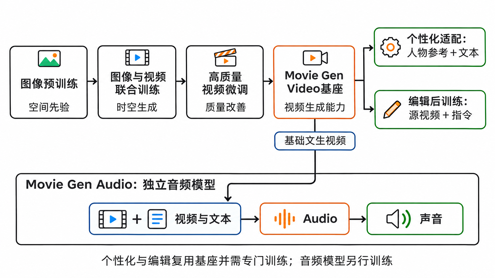
  <p>图3-3 Movie Gen 视频基座的训练、任务适配与独立音频生成</p>
</div>

**2、音频生成如何与视频模型配合？**

Movie Gen Audio 是专门的音频模型，可以根据视频及文本条件生成与画面同步的音效、环境声和音乐，也支持文本生成音频。它读取视频所提供的事件与时间信息，再生成对应声音；并非将视频基座直接微调成音频模型[1]。

例如，音频模型可根据人物在雨中行走的视频生成雨声与脚步声，声画同步仍需单独检查。

*两种音频建模方式可与[4.3.4.4](#q-4-3-4-4)对照。*Veo 3 披露了音视频潜变量的联合扩散，Movie Gen 则由独立音频模型根据视频生成声音。相似的声画输出，可以来自不同的模型组织方式，效果与成本需要结合具体任务评估。

**3、为什么称为“媒体基础模型家族”？**

“媒体”强调它覆盖视频与音频生成，以及个性化和编辑等任务；“基础”强调预训练能力能够作为后续任务适配的起点；“家族”则说明这些能力由相互关联的多个模型承担。

> **面试速答**：Movie Gen 以视频生成模型为基座，通过专门训练扩展出人物个性化和指令编辑能力；音频则由独立模型根据视频与文本等条件生成。个性化和编辑复用的是视频基座的预训练能力，音频模型利用的是视频提供的内容与时间信息。这构成了媒体基础模型家族，而非一个模型自动完成全部任务。

### <a id="q-4-3-4-6"></a>4.3.4.6 面试问题：Movie Gen Video 如何结合时空压缩、Transformer 与并行训练，支持大规模视频生成？

**难度评分：⭐⭐⭐⭐ (4/5)  |  考察频率：⭐⭐⭐ (3/5)**

Movie Gen Video 的路线是：**先压缩视频以控制输入规模，再用 Transformer 学习潜空间生成，并通过并行训练分担大模型与长序列的计算和显存开销。** 三者解决的问题不同，需要配合设计。

**1、先控制视频表示的规模**

Movie Gen 使用时空自编码器（TAE），压缩视频的空间尺寸与时间长度，再将潜变量切块，转换为 Transformer 的输入 token。

论文最大视频主干为 30B 参数，训练上下文最长约为 73K 视频 token。这些 token 来自压缩、切块后的时空位置，**不是 73K 帧，也不是文本提示词长度**。论文中这一训练配置对应约 16 秒、16 FPS 的视频[1]。

因此，上下文长度需要结合分辨率、帧数、压缩比例和切块尺寸理解，不能单独换算为固定的视频时长。

*关于潜空间压缩与 token 化的通用原理，参见[4.2.2.3](02_AI视频生成原理与模型架构.md#q-4-2-2-3)和[4.2.4.2](02_AI视频生成原理与模型架构.md#q-4-2-4-2)。*

**2、用 Transformer 处理整段视频的生成**

Movie Gen 的主干参考 Llama 3 的 Transformer 结构，但根据视觉生成任务进行了调整：

- **使用双向注意力。** 各时空位置可以交换信息，生成过程不按语言模型的方式逐个预测下一个 token。
- **加入文本与生成时间步条件。** 文本通过交叉注意力进入主干，生成时间步通过自适应归一化等路径参与计算。
- **采用 Flow Matching 训练。** 主干学习预测潜变量从噪声向数据变化的速度，推理时由数值求解器逐步更新潜变量[1]。

这里的生成时间步表示采样过程所处的位置，与视频中的帧时间不同。沿用部分语言模型结构，也不意味着采用相同的训练目标或自回归生成方式。

图3-4区分了训练时的表示准备与推理时的迭代生成，并展示文本条件、生成阶段和解码输出之间的关系。

<div align="center">
  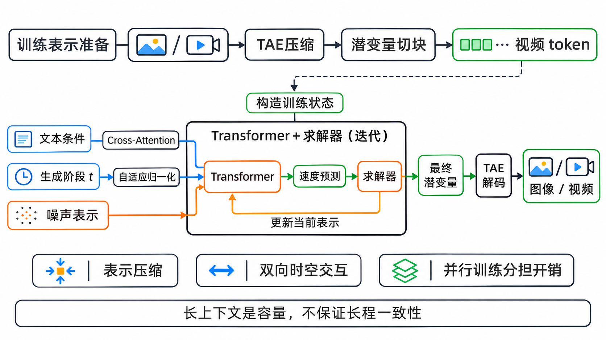
  <p>图3-4 Movie Gen 的表示准备与生成推理流程</p>
</div>

**3、用并行训练承担模型和序列的开销**

压缩后的视频序列仍然很长，单张设备需要容纳模型参数、训练状态和中间激活，并完成大量注意力计算。

论文组合使用参数分片、张量并行及序列／上下文并行等方法，将这些开销分担到多张设备。可以分别理解为：

- **分担模型状态：** 减少每张设备需要保存的参数、梯度和优化器状态。
- **拆分层内计算：** 将较大的矩阵运算分配给多张设备。
- **拆分序列相关计算：** 分担长视频 token 带来的激活与注意力开销。

这些方法会引入设备间通信，因此，并行规模越大并不必然越快。实际配置需要结合显存、计算速度与互连带宽选择[1]。

**长上下文提供容量，但不保证长程状态保持或多镜头叙事能力，仍需通过训练与评测验证。**

> **面试速答**：Movie Gen Video 先用 TAE 和切块控制视频 token 规模，再用带文本与时间步条件的双向 Transformer，通过 Flow Matching 学习生成。训练时组合参数分片、张量及序列／上下文并行，分担模型状态、计算和激活开销。这条路线体现了表示、主干与工程的协同设计；大参数量和长上下文提供容量，但不自动保证长程一致性。

### <a id="q-4-3-4-7"></a>4.3.4.7 面试问题：从 Sora、Veo 与 Movie Gen 的公开资料看，视频生成有哪些共同技术方向？哪些设计仍存在明显差异？

**难度评分：⭐⭐⭐⭐ (4/5)  |  考察频率：⭐⭐⭐⭐ (4/5)**

这三个案例在压缩表示、Transformer 主干和能力扩展上有相近方向，但生成目标、音频建模与任务组织并不完全相同。**比较时需要限定版本和资料范围，不能将某个模型的设计直接当作其他模型的实现。**

以下主要依据 2024 年 Sora 技术报告、Veo 3 技术报告，以及 Movie Gen 论文。

**1、公开资料支持哪些共同方向？**

表3-5概括了三个案例的主要设计。

<p align="center">表3-5 Sora、Veo 与 Movie Gen 的公开路线比较</p>

| 比较维度 | Sora（2024 年报告） | Veo 3（技术报告） | Movie Gen |
| --- | --- | --- | --- |
| 视觉表示与主干 | 时空压缩、时空 patch、扩散 Transformer | 压缩的视频潜变量、基于 Transformer 的去噪网络 | TAE、潜变量切块、Transformer |
| 生成目标 | 扩散去噪 | 音视频潜变量联合扩散 | 视频主干采用 Flow Matching |
| 能力扩展 | 图像与视频生成，以及图像／视频条件下的生成与编辑 | 文本条件下生成含音频的视频 | 视频基座进一步适配个性化与编辑，另有音频模型 |
| 音频组织 | 该报告未讨论音频生成 | 音视频联合建模 | 独立音频模型根据视频与文本等条件生成声音 |

资料依据：Sora 技术报告[5]、Veo 3 技术报告[7]、Movie Gen 论文[1]。

可以归纳出两点共同方向：

- **在压缩表示上使用 Transformer 进行生成建模。** 压缩控制视频表示的规模，Transformer 处理条件与时空信息。三者都有这一层面的依据，但具体压缩器、切块与注意力设计不能视为相同。
- **能力范围超出单一文生视频。** 参考条件、编辑和任务适配提供更具体的内容控制，音频生成则扩展了输出模态。但这些能力是否共享参数、如何训练，需要分别查看技术披露。

**2、哪些设计不能概括为相同路线？**

**（1）生成主干相近，不代表训练目标相同。**

Sora 和 Veo 3 的上述资料采用扩散表述，Movie Gen 视频主干采用 Flow Matching。即使都使用 Transformer，学习的预测量和采样更新方式仍需按具体方案解释。

*相关原理参见[4.2.3.2](02_AI视频生成原理与模型架构.md#q-4-2-3-2)。*

**（2）最终都有声音，不代表音视频联合生成。**

Veo 3 将音视频纳入联合扩散建模，Movie Gen 由独立音频模型读取视频等条件生成声音。这是不同的模型组织方式；是否同步、效果如何，仍需实际评价。

*两条路线分别参见[4.3.4.4](#q-4-3-4-4)和[4.3.4.5](#q-4-3-4-5)。*

**（3）功能覆盖广，不代表所有任务由同一个模型完成。**

共同表示、共同预训练基座、相同模型参数，以及同一产品中的多个功能，是不同层面的复用。不能仅凭功能列表推断底层只有一个模型。

例如，首尾帧生成需要匹配两端状态，视频延展需要衔接已有运动；这些能力可以由不同的适配模型或推理流程提供。*具体任务边界参见[4.3.1.2](#q-4-3-1-2)。*

> **面试速答**：三个案例都体现了压缩表示与 Transformer 生成主干的结合，能力也超出了单一文生视频。但它们的生成目标、音频建模和任务适配方式存在差异：例如 Movie Gen 使用 Flow Matching，Veo 3 采用音视频联合扩散，Movie Gen 音频则由独立模型生成。应比较具体设计及任务效果，不能从相似功能推断相同架构。

## <a id="q-4-3-5"></a>4.3.5 开放视频生成模型的代表设计与技术取舍

> 本节选取 Open-Sora、HunyuanVideo、Wan、Step-Video、CogVideoX 与 MiniMax-H3，比较模型复用、条件融合、噪声阶段分工、压缩与后训练，以及多模态音视频生成。它们是不同的代表方案，具体设计均按版本说明。开放范围也各不相同：代码、权重和训练数据是否提供，以及完整流程能否本地复现，需要分别核对。这里侧重模型设计，下一节进一步讨论面向实际创作的效率、控制能力和流程配合。

### <a id="q-4-3-5-1"></a>4.3.5.1 面试问题：Open-Sora 2.0 如何通过模型复用与分阶段训练控制视频模型的训练成本？

**难度评分：⭐⭐⭐⭐ (4/5)  |  考察频率：⭐⭐⭐⭐ (4/5)**

Open-Sora 提供了视频生成的开放模型与训练实现。以 **Open-Sora 2.0** 为例，控制成本的主要做法是复用已有图像模型、先在低分辨率上学习运动，再进行高分辨率适配，而不只依靠更快的计算算子。

**1、复用图像能力，减少从头训练的开销**

Open-Sora 2.0 使用 FLUX 图像生成模型初始化视频主干，再进行视频训练。已有图像能力提供外观与文本对应的基础，再通过视频数据学习时间变化；这不局限于冻结图像主干、只增加时间模块。

其主干采用双流与单流结合的 Transformer 和全注意力。早期 Open-Sora 的 STDiT 不能直接当作 2.0 的架构说明[8]。

**2、把训练预算分配到不同阶段**

- **低分辨率视频训练：** 先学习运动和语义对应，减少早期高分辨率计算。
- **高质量数据筛选：** 在高分辨率适配时使用筛选更严格的数据，控制有限预算所处理的样本质量。
- **借助 I2V 适配高分辨率：** 论文发现，以图像作为条件进行分辨率适配更高效，并采用先生成图像、再生成视频的推理方式。这个结果属于其具体实验，不能推广为所有 I2V 都比 T2V 便宜。
- **按尺寸分桶并配置批量：** 根据视频的分辨率、帧数和宽高比组织训练，减少批处理中的无效计算。

论文报告的约20万美元是按指定硬件租价估算的一次训练运行成本；它复用了已有模型，不能将该数字理解为从零研发、数据处理和全部实验的总成本[8]。

**3、怎样理解其开放价值？**

公开模型与训练实现，使读者能够检查模型复用、分阶段训练和系统优化的具体做法，并核对成本估算所依赖的配置。具体复现仍取决于数据获取、硬件和训练设置，公开代码与权重不代表训练数据也全部公开。

图3-5概括了模型复用、分阶段训练及相应的推理组织方式。

<div align="center">
  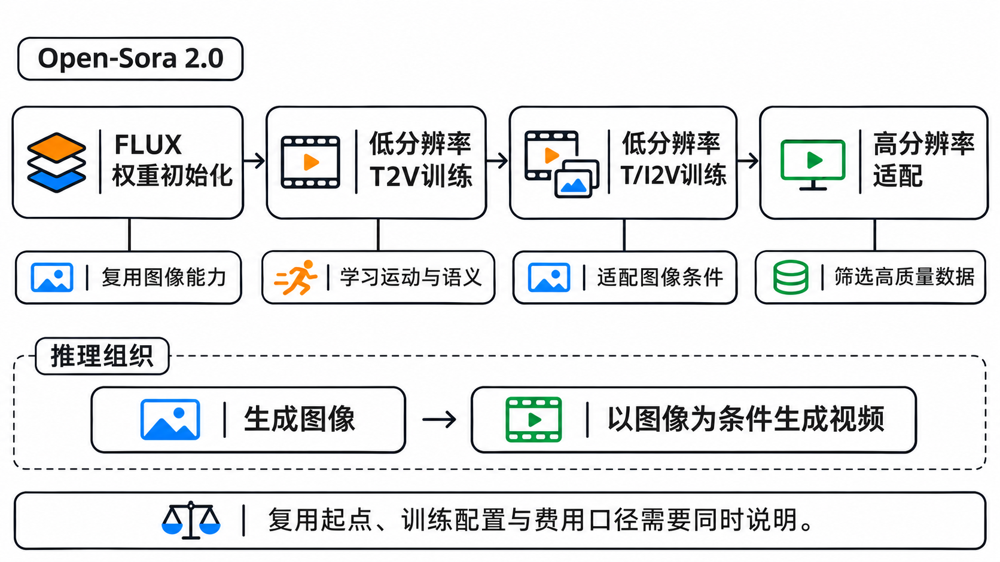
  <p>图3-5 Open-Sora 2.0 的模型复用与分阶段训练</p>
</div>

*关于可变尺寸分桶与组批，参见[4.5.2.3](05_视频生成训练与工程优化.md#q-4-5-2-3)。*

> **面试速答**：Open-Sora 2.0 通过 FLUX 初始化复用图像能力，先做低分辨率视频训练，再结合高质量数据和 I2V 进行高分辨率适配，并用分桶与批量配置控制计算成本。分析它时要同时看模型版本、复用起点和成本口径，不能把一次训练费用当作完整研发成本。

延伸阅读：[Open-Sora 官方仓库](https://github.com/hpcaitech/Open-Sora)

### <a id="q-4-3-5-2"></a>4.3.5.2 面试问题：HunyuanVideo 如何处理文本条件，并通过双流到单流结构融合文本与视频？

**难度评分：⭐⭐⭐⭐ (4/5)  |  考察频率：⭐⭐⭐⭐ (4/5)**

以下讨论原始 HunyuanVideo 13B 模型的公开设计。它使用多模态大语言模型提供文本特征，并采用**双流到单流的 Transformer**，在保留不同模态处理路径的同时，让文本与视频进行交互。

**1、文本条件如何进入模型？**

HunyuanVideo 将预训练多模态大语言模型（MLLM）用作文本编码器，提取提示词的序列特征。这里使用的是它的文本编码能力，不能据此推断视频主干接收了任意多模态输入。

由于该编码器采用因果注意力，模型另外加入双向 token refiner，让文本位置进一步结合前后文更新特征。CLIP 提供的全局文本特征则与生成时间步信息配合，参与主干中的条件控制[9]。

**2、双流与单流分别处理什么？**

- **双流阶段：** 文本与视频分别使用各自的归一化、投影和前馈处理路径，再通过注意力交换信息。官方实现中，两个流的查询、键和值会拼接后参与注意力计算，因此“双流”不代表两种模态完全不交互。
- **单流阶段：** 文本与视频 token 合并后，进入共同的 Transformer 处理路径，继续建立跨模态和跨时空关系。

这套组织允许前段保留模态各自的处理参数，后段进一步共享计算。它与直接采用一个共享序列的结构有所不同，但效果优劣仍需具体实验判断[10]。

图3-6展示了文本条件处理、双流交互与单流融合的关系。

<div align="center">
  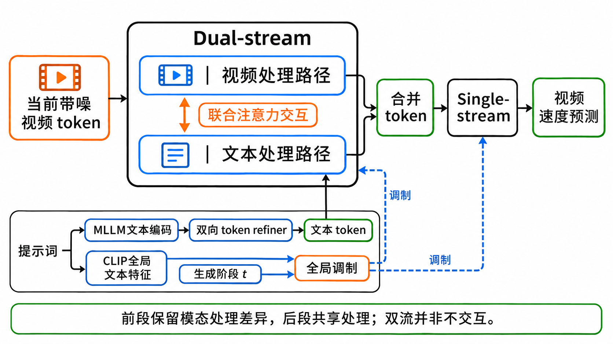
  <p>图3-6 HunyuanVideo 的文本条件处理与双流到单流融合</p>
</div>

**3、这些设计如何与视频生成配合？**

Causal 3D VAE 先压缩视频，主干在潜空间中通过 Flow Matching 学习生成，并用时空位置编码区分视频中的时间与空间位置。文本处理和双流／单流结构需要与这套表示、训练数据共同适配，不能只用编码器规模或主干参数量解释生成能力。

*条件注入的通用原理参见[4.2.1.3](02_AI视频生成原理与模型架构.md#q-4-2-1-3)。*

> **面试速答**：HunyuanVideo 用 MLLM 提供文本序列特征，经双向 refiner 进一步处理，并结合 CLIP 全局文本特征。双流阶段保留模态各自的处理参数，同时进行注意力交互；单流阶段合并 token 继续共享计算。它们与视频压缩、时空位置表示和 Flow Matching 配合，完成条件视频生成。

延伸阅读：[HunyuanVideo 官方仓库](https://github.com/Tencent-Hunyuan/HunyuanVideo)

### <a id="q-4-3-5-3"></a>4.3.5.3 面试问题：Wan2.2 A14B 为什么按噪声阶段划分专家？这种分工有哪些收益与代价？

**难度评分：⭐⭐⭐⭐ (4/5)  |  考察频率：⭐⭐⭐⭐ (4/5)**

Wan2.2 A14B 系列将生成过程划分为高噪声与低噪声阶段，分别由两个专家处理。**分工依据是采样过程中的噪声水平，而不是视频的前后时间段，也不是按每个 token 进行稀疏路由。** 以下讨论限定于 A14B 系列，不适用于 Wan2.2 的全部型号。

**1、为什么按噪声阶段分工？**

高噪声阶段需要从较强噪声中形成整体内容与布局，低噪声阶段则进一步完善外观和细节。不同阶段的输入状态与生成重点不同，分别训练和使用专家，可以让各自的参数更集中地适应对应阶段。

采样时，按照噪声水平选择相应专家；跨过阶段边界后切换，而不是两个专家在每一步都完成一遍生成[11]。

**2、容量增加与部署成本如何权衡？**

两个专家增加了总参数容量，但每步只计算其中一个。

不过，每步激活参数量只反映当前参与计算的参数，不能代表全部权重存储或部署显存。两套专家同时驻留设备，还是按阶段加载，会影响显存、数据搬运和切换开销。分析收益时，需要区分总参数、每步计算与完整生成延迟。

**3、与基础视频生成链路是什么关系？**

作为对照，Wan2.1 的代表链路使用 Wan-VAE、umT5 文本编码与采用 Flow Matching 的 DiT。噪声阶段专家分工关注的是生成主干如何处理不同采样阶段，不应与 VAE 的编解码或文本条件处理混为一谈[12]。

选择权重时仍需核对版本、任务、编码器和资源要求。例如，Wan2.2 的5B TI2V模型需单独查看其架构，不能套用 A14B 的双专家说明。

图3-7沿采样噪声轴展示了两个专家的作用阶段，不表示视频前后时间段的划分。

<div align="center">
  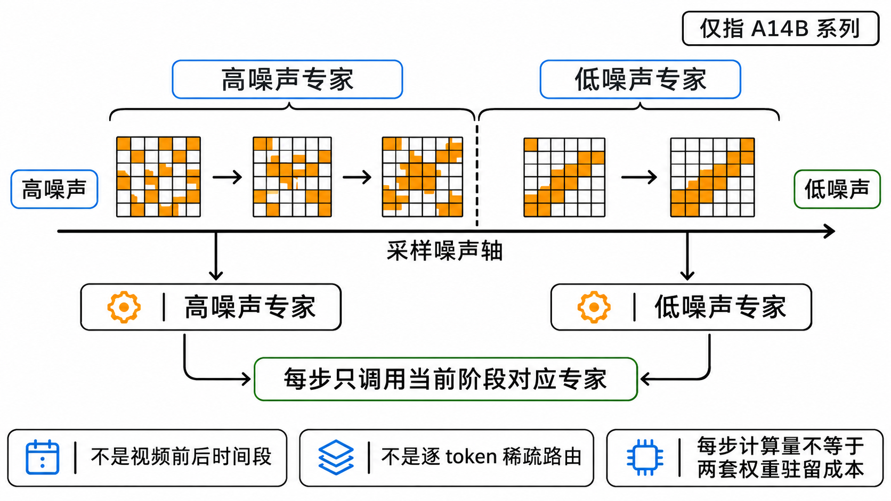
  <p>图3-7 Wan2.2 A14B 按采样噪声阶段调用专家</p>
</div>

> **面试速答**：Wan2.2 A14B 按高低噪声阶段使用不同专家，让模型分别适应整体内容形成与细节完善。每步仅调用对应专家，增加总容量而无需每步计算全部专家；但两套权重的存储、加载与切换仍有成本。这是采样噪声阶段的分工，不是视频时间段划分或逐 token 路由。

### <a id="q-4-3-5-4"></a>4.3.5.4 面试问题：Step-Video 如何用深压缩表示配合大规模视频生成主干？有哪些取舍？

**难度评分：⭐⭐⭐⭐ (4/5)  |  考察频率：⭐⭐⭐ (3/5)**

Step-Video-T2V 先用深压缩 Video-VAE 减少视频的时空位置，再用30B全时空注意力 DiT 在潜空间中生成。**压缩降低主干的序列负担，但能否保留细节与运动，决定了后续生成可利用的信息质量。**

**1、深压缩如何减轻主干计算？**

其 Video-VAE 的空间下采样为每个方向16倍，时间下采样为8倍。忽略边界取整后，潜变量网格的位置数约为：

```math
N_{\mathrm{grid}} \approx \frac{T}{8}\times\frac{H}{16}\times\frac{W}{16}
```

网格位置数约为原始像素时空位置数的1/2048。这是位置数量的比例，不是总数值量或视频文件大小的压缩比例；潜变量通道数与数据精度仍需另行考虑。

较少的潜空间位置减轻了后续全时空注意力的计算与显存负担，使大规模主干能够在更紧凑的表示上处理跨帧关系。主干采用 Flow Matching 学习从噪声生成视频潜变量，再由 VAE 解码输出[13]。

**2、压缩带来哪些质量取舍？**

空间压缩可能损失文字、小物体和纹理；时间压缩可能影响短暂动作与快速变化。主干更大，也不能保证恢复编码阶段丢失的信息。

应先检查 VAE 重建，再评价完整生成结果，不能仅凭高压缩率判断方案更优。位置数减少比例也不等于推理加速倍数，主干规模、采样步数和编解码仍影响总开销。

**3、后训练与图生视频扩展承担不同作用**

Step-Video 还使用 Video-DPO 调整生成偏好[13]。后续 TI2V 在基座上增加首帧潜变量与运动强度条件，并通过相应训练学习利用它们[14]。这些设计分别改善生成倾向和条件控制，不代替压缩表示与主干的配合，也不能补回所有压缩损失。

> **面试速答**：Step-Video 以时空深压缩减少潜变量位置，让30B全时空注意力主干在较短序列上学习生成。收益是降低序列计算负担，取舍是细节与快速运动可能在压缩中受损，需要结合 VAE 重建、生成质量和完整推理成本判断。后训练与 TI2V 条件适配解决的是偏好和控制问题。

延伸阅读：[Step-Video-T2V 官方仓库](https://github.com/stepfun-ai/Step-Video-T2V)

### <a id="q-4-3-5-5"></a>4.3.5.5 面试问题：CogVideoX 的 3D Causal VAE 与 Expert Transformer 如何配合？Expert 指什么？

**难度评分：⭐⭐⭐⭐ (4/5)  |  考察频率：⭐⭐⭐⭐ (4/5)**

CogVideoX 先用 3D Causal VAE 压缩视频，再将视频与文本 token 交给 Expert Transformer。**VAE 负责视觉表示，Transformer 负责条件与时空信息的交互；这里的 Expert 主要指模态专属的自适应归一化。**

**1、3D Causal VAE 提供什么表示？**

3D VAE 联合处理连续帧，在空间与时间上压缩视频；因果时间卷积使当前潜变量的编码不读取未来帧。相比逐帧压缩，它能够利用相邻帧信息，但压缩率和潜变量通道数仍影响重建质量及生成学习难度。

这一因果性属于视频编解码组件。生成主干仍采用双向的时空交互，不能仅凭 VAE 的名称判断整个模型是自回归生成或支持流式输出。

**2、Expert Transformer 如何融合文本与视频？**

文本与视频编码后拼接为序列，通过全注意力进行跨模态与跨时空交互。不同时间和空间位置由时空位置编码加以区分。

由于文本与视觉特征的分布和数值尺度不同，模型分别为两种模态设置 Expert AdaLN。它根据扩散时间步生成相应参数，调整文本或视频特征，再参与共同的 Transformer 计算[15]。

这里的 Expert 不涉及每个 token 在多个前馈专家之间的稀疏路由。这种模态专属归一化也不同于 Wan2.2 A14B 的噪声阶段专家。*后者见[4.3.5.3](#q-4-3-5-3)。*

图3-8展示了模态专属归一化与共享全注意力的关系。

<div align="center">
  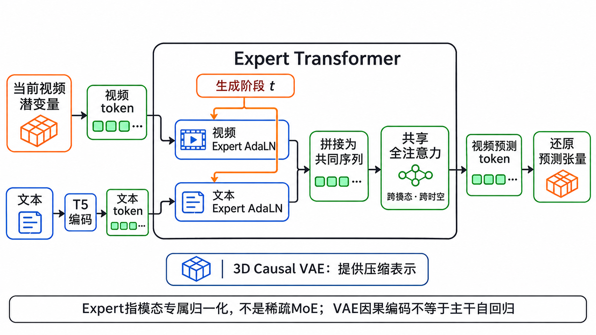
  <p>图3-8 CogVideoX 的模态专属归一化与共享全注意力</p>
</div>

**3、这种组合的取舍是什么？**

全注意力允许不同帧、不同空间位置直接交换信息，不要求运动对象始终位于相同坐标；但对象对应关系仍需训练学习，序列变长也会增加成本。模态专属归一化则让部分处理适应各自特征，同时继续共享注意力等计算。

*这里的结构选择可与[4.3.5.2](#q-4-3-5-2)的双流到单流融合对照。通用注意力取舍参见[4.2.5.2](02_AI视频生成原理与模型架构.md#q-4-2-5-2)。*

> **面试速答**：CogVideoX 的因果 3D VAE 负责压缩连续视频，Expert Transformer 将文本与视频 token 放入共同注意力序列，并用模态专属 AdaLN 分别调整两类特征。Expert 在这里指模态处理差异，不是稀疏 MoE；VAE 的因果编码也不等于生成主干采用自回归方式。

延伸阅读：[CogVideo 官方仓库](https://github.com/zai-org/CogVideo)

### <a id="q-4-3-5-6"></a>4.3.5.6 面试问题：CogVideoX 为什么采用混合时长、Multi-Resolution Frame Pack 与渐进分辨率训练？

**难度评分：⭐⭐⭐⭐ (4/5)  |  考察频率：⭐⭐⭐⭐ (4/5)**

这些方法处理的是不同形状的视频如何参与训练，以及训练预算如何分配。以下依据 CogVideoX 论文中的训练方案，不将它们直接概括为所有视频模型的最佳配置。

**1、混合时长训练为什么有用？**

如果训练只使用单帧图像和固定帧数的视频，中间长度的样本覆盖较少；固定帧数还可能导致短片段被丢弃、较长片段被截断。

CogVideoX 因此混合不同长度的视频与图像，让训练接触更多时间尺度。模型是否能处理这些长度，仍需结合相应长度的生成结果验证。

**2、Multi-Resolution Frame Pack 解决什么问题？**

不同帧数、分辨率和宽高比产生不同的输入形状，直接组成规整批次比较困难。论文受 Patch’n Pack 启发，设计 Multi-Resolution Frame Pack，在批处理中组织这些可变形状样本，并结合 3D RoPE 表示各样本自己的时空位置[15]。

实现类似方案时，还需处理样本边界与各自的位置信息，避免将不同视频误当作连续片段。

*可变尺寸分桶与组批的通用方法，参见[4.5.2.3](05_视频生成训练与工程优化.md#q-4-5-2-3)。*

**3、渐进分辨率与数据处理如何配合？**

论文先在 256px 分辨率训练，再逐步提高到 512px、768px，并保留样本宽高比。低分辨率阶段降低计算开销，后续阶段再学习更细的视觉内容，最后进行高质量微调。

数据方面，论文筛除存在明显剪辑干扰、运动不连贯或画面质量差的片段，并重新生成较详细的视频描述，为主体、动作和场景关系提供监督[15]。

这些筛选标准服务于其训练目标，不能推广为“含文字、低运动或有剪辑的视频都不值得训练”。例如，文字生成、多镜头和说话视频就需要各自相应的数据。

> **面试速答**：CogVideoX 混合不同长度的图像和视频样本，用 Multi-Resolution Frame Pack 组织可变形状的批次，再逐步提高训练分辨率，以利用更多数据并控制成本。数据筛选和详细描述提供相应监督。混合时长覆盖不同时间尺度，渐进分辨率则用于分配不同清晰度阶段的训练预算。

### <a id="q-4-3-5-7"></a>4.3.5.7 面试问题：MiniMax-H3 如何利用多模态参考生成音视频？开放的 H3-Base 与完整生成流程有什么区别？

**难度评分：⭐⭐⭐⭐ (4/5)  |  考察频率：⭐⭐⭐ (3/5)**

H3-Base将文本、图像、视频和音频分别编码，通过共享主干联合生成音视频。**完整H3流程还包含上下文处理与2K再生成，需要区分基座模型与完整流程的能力。**

**1、不同模态怎样编码？**

H3-Base采用以下编码路径：

- **文本：** H3-Encoder。
- **图像与视频：** H3-Encoder和H3-VisualVAE。
- **音频：** H3-AudioVAE。

视觉输入的两条路径分别提供信息：H3-Encoder侧重语义理解，H3-VisualVAE提供用于视觉生成的潜变量，即编码后的压缩表示[16]。

编码后的各类特征被组织为多模态token序列，并加入相应的时空位置信息，供共享主干处理。

**2、共享主干怎样联合生成音视频？**

H3-Omni-Transformer共同处理多模态序列，联合预测视频与音频潜变量，再由各自的解码器输出画面和立体声音频。音画联系在生成过程中建模，而非生成视频后再独立配音。

音频与视频共享主干中的注意力层和前馈层，同时保留各自的输入输出层和条件处理分支[16]。

生成后还需检查口型是否匹配语音、动作音效是否出现在对应时刻。

**3、完整流程怎样生成高分辨率结果？**

完整H3流程包含三个模块[17]：

<p align="center">表3-6 MiniMax-H3 完整生成流程的模块与作用</p>

| 模块 | 主要作用 |
| --- | --- |
| **H3-Context-IR** | 整理指令、参考素材的用途及对应关系，形成生成模块使用的结构化上下文 |
| **H3-Base** | 根据上下文与参考素材生成768p音视频 |
| **H3-Regenerate-2K** | 结合原始上下文与基座结果，再生成2K输出 |

图3-9展示了完整流程。原始上下文不仅用于基础生成，也参与2K再生成，使后续阶段继续利用参考信息。

<div align="center">
  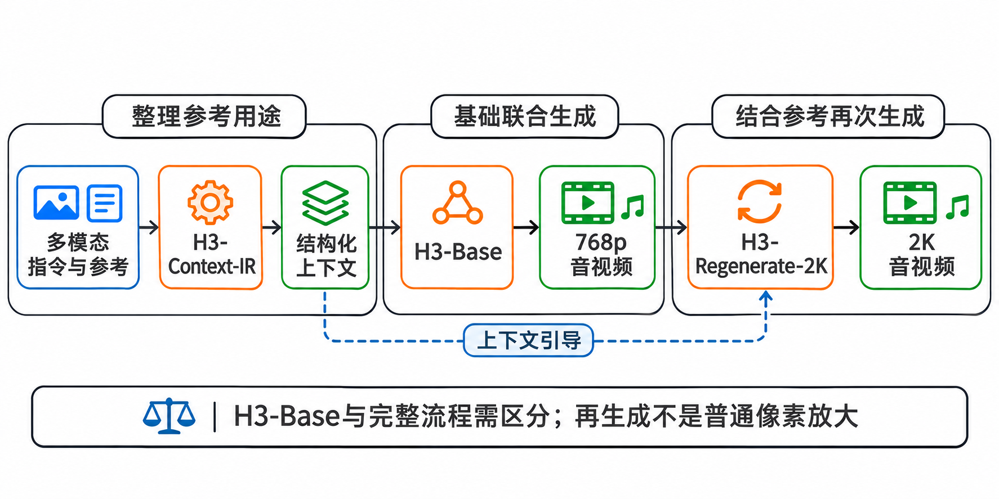
  <p>图3-9 MiniMax-H3 的上下文处理、基础音视频生成与高分辨率再生成</p>
</div>

本图依据[MiniMax-H3 官方说明](https://www.minimax.cn/news/minimax-h3-open-source)整理绘制。

2K阶段会重新生成细节，因此还需检查人物身份、动作及参考内容是否保持。

**4、开放的H3-Base与完整流程有什么区别？**

官方发布了两类任务权重：

- **H3-Base-FL2VA：** 支持文本及可选首帧、尾帧条件下的音视频生成。
- **H3-Base-Ref2VA：** 支持多模态参考音视频生成。

使用时应根据首尾帧生成或多模态参考生成任务，选择对应权重。

*按所引用的官方发布说明，Context-IR与Regenerate-2K未包含在这次开放发布中；复现完整2K工作流，需要组合本地Base与官方API[17]。*

因此，比较效果时应明确使用了哪些组件，区分开放基座的输出与完整服务流程的结果。

> **面试速答**：H3-Base将不同模态分别编码，由共享主干联合预测音视频潜变量，再分别解码。完整流程还包含参考素材与指令的整理，以及利用原始参考进行2K再生成。开放的两类Base权重分别支持首尾帧条件和多模态参考生成，不能将完整流程的效果直接归为单个开放基座的能力。

---

## <a id="q-4-3-6"></a>4.3.6 视频生成的质量、控制与效率：代表模型案例

> 本节比较满足创作要求时的不同设计取舍：Seedance 1.0 用后训练与加速兼顾质量和效率，Kling-Omni 组织多模态指令理解、生成与细化，原始 LTX-Video 协同设计压缩表示和解码去噪。各题限定具体报告和版本；模型设计案例在这里展开，部署调度与项目级工作流分别见第五章和第六章。

### <a id="q-4-3-6-1"></a>4.3.6.1 面试问题：Seedance 1.0 如何通过后训练与推理加速，兼顾生成质量和效率？

**难度评分：⭐⭐⭐⭐ (4/5)  |  考察频率：⭐⭐⭐ (3/5)**

Seedance 1.0 用监督微调和人类反馈改善质量，通过蒸馏减少主干调用，再优化解码器与算子执行。**它还针对加速后的细化模型继续优化，使质量训练适应实际的少步生成配置。**

**1、通过微调与多维奖励改善质量**

监督微调（SFT）使用精选视频与经过核验的描述，改善内容生成和条件遵循。随后引入三类奖励模型：

- **基础奖励模型：** 关注文本与画面对应、结构稳定。
- **运动奖励模型：** 关注运动幅度、表现力及动态伪影。
- **审美奖励模型：** 关注画面的视觉表现。

三类评分组合为优化目标，用于更新生成模型[18]。

*下面是组合奖励目标的教学简式，不是论文完整损失函数：*

```math
\max_{\theta}\;
\mathbb{E}_{c,\epsilon}
\left[
\lambda_b R_b(\hat V,c)
+\lambda_m R_m(\hat V,c)
+\lambda_a R_a(\hat V,c)
\right],
\qquad
\hat V=G_{\theta}(\epsilon,c)
```

其中， $c$ 是生成条件， $\epsilon$ 表示生成随机性， $G_\theta$ 表示生成过程， $\hat V$ 是生成视频；三个 $R$ 分别表示基础、运动和审美评价， $\lambda$ 为对应权重。

例如，“人物拿起杯子”的结果可能画面漂亮却未完成动作，也可能动作完成但手部变形，因此需要同时评价指令遵循、结构、运动和观感。这里的奖励参与参数更新，不只是对生成候选排序。

**2、通过蒸馏减少采样计算**

蒸馏让学生模型经过训练，用更少次更新逼近教师的多步生成过程。Seedance 1.0采用轨迹分段一致性蒸馏（Trajectory Segmented Consistency Distillation，TSCD），将生成轨迹划分为多个区间，在区间内施加一致性约束[18]。

*下面仅示意少步更新的目标，不是TSCD的具体损失函数：*

```math
S_{\theta}(z_t,t,s,c)
\approx
\Phi_{\mathrm{teacher}}(z_t,t\rightarrow s,c)
```

其中， $z_t$ 是带噪潜变量， $t$ 和 $s$ 是生成过程中的噪声时间步； $\Phi_{\mathrm{teacher}}$ 表示教师从 $t$ 更新到 $s$ 的过程， $S_\theta$ 表示学生学习的少步更新映射。这里的时间步与视频帧序号无关。

学生接受了少步更新训练，与直接调低原模型的采样步数不同。减少主干调用即可降低累计计算，不要求同时缩小模型。

报告还使用Score Distillation对齐教师与学生的噪声预测，并结合判别器反馈和人类偏好监督，减少加速后的伪影[18]。

**3、继续优化加速后的质量与解码效率**

**优化少步细化模型。** 细化模型以低分辨率视频潜变量为条件，生成高分辨率结果。报告直接对加速后的细化模型进行人类反馈优化：评价其高分辨率输出，再用组合奖励更新参数，改善少步生成中的运动与视觉问题[18]。

**降低解码开销。** 主干加速后，VAE解码可能成为瓶颈。报告通过耗时分析，缩窄靠近像素输出、计算开销较大的解码层通道，固定预训练编码器并重新训练轻量解码器；同时通过算子融合，减少中间结果的显存读写和算子启动开销[18]。

最终应在相同硬件与输出要求下，比较生成质量、采样配置和端到端耗时。

*后训练原理见[4.5.3.3](05_视频生成训练与工程优化.md#q-4-5-3-3)，推理加速方法及代价见[4.5.6.2](05_视频生成训练与工程优化.md#q-4-5-6-2)。*

> **面试速答**：Seedance 1.0 通过精选数据微调和多维奖励反馈改善生成质量，通过蒸馏减少采样步骤，再优化 VAE 解码与算子执行成本。它还直接优化加速后的细化模型，使少步生成的高分辨率结果继续满足运动与视觉质量要求。

延伸阅读：[Seedance 1.0 官方技术解读](https://seed.bytedance.com/en/blog/tech-report-of-seedance-1-0-is-now-publicly-available)

### <a id="q-4-3-6-2"></a>4.3.6.2 面试问题：Kling-Omni 如何结合多模态指令理解、视频生成与超分辨率，支持参考生成和编辑？

**难度评分：⭐⭐⭐⭐ (4/5)  |  考察频率：⭐⭐⭐ (3/5)**

Kling-Omni通过三个组件完成生成：**Prompt Enhancer理解素材与指令，Omni-Generator生成基础视频，多模态超分辨率模块结合基础视频与原始条件，生成高分辨率结果。**

*以下依据2025年发布的Kling-Omni技术报告。*

**1、理解素材用途，组织生成条件**

报告将文本指令、参考图像与视频上下文的组合输入称为多模态视觉语言（MVL）。除了识别素材内容，还需要理解各素材的用途。

例如：

> 使用参考图中的人物外观，保留源视频的动作与镜头，将场景改为雨夜街道。

人物图提供外观，源视频提供运动与构图，文本说明修改和保持要求。

Prompt Enhancer（PE）使用多模态大语言模型，将这些输入改写为更接近生成模型训练描述的条件。PE先经过监督微调，再通过强化学习优化描述的事实准确性、完整性、语义合理性及其与高质量训练描述的匹配程度[19]。

改写仍应遵守原要求：可以补充雨夜环境，但不能擅自改变人物动作或镜头。

**2、通过任务训练学习参考生成与编辑**

Omni-Generator在共享嵌入空间中处理视觉与文本token，通过三个阶段扩展能力：

- **预训练：** 以文生视频为基础，混入图生视频，学习同时利用视觉与文本条件。
- **继续训练：** 加入参考生成、图像与视频编辑，以及图文视频交错输入，学习素材与目标结果之间的关系。
- **质量微调：** 使用任务分布均衡、视频质量较高且指令准确的数据，改善输出质量[19]。

**3、提升分辨率，并降低重复计算**

**（1）结合原始条件补充细节**

基础视频可能丢失服装纹理、面部细节或小物体信息。因此，超分辨率模块同时读取低分辨率潜变量与原始MVL条件，利用参考素材补充高分辨率细节。该模块采用基础模型的架构，并以其预训练权重初始化。

为控制高分辨率token的注意力开销，模块采用局部窗口；在交替层中将窗口移动半个窗口大小，让原本位于不同窗口的token也能交换信息[19]。

分辨率提升不保证纠正基础视频中的身份或动作错误，仍需检查内容是否正确。

**（2）通过非对称注意力复用条件特征**

如果条件token不断读取当前带噪视频，其特征也会随采样变化，难以跨步缓存。

Kling-Omni在超分辨率模块中限制了这一依赖：**条件侧不读取带噪视频，带噪视频侧仍可读取条件**[19]。

*下面仅示意读取关系，省略窗口内部的具体连接：*

```math
\begin{array}{c|cc}
\text{查询来源}\backslash\text{读取对象}
& C & Z_t\\ \hline
C   & \checkmark & \times\\
Z_t & \checkmark & \checkmark
\end{array}
```

其中， $C$ 是条件token， $Z_t$ 是当前生成步骤的带噪token；勾号表示允许读取，不是实际注意力权重。

跨采样步骤保持不变的条件表示，其键和值（KV）可以计算一次、后续复用，减少重复计算[19]。如果条件特征仍受时间步等因素影响，则不能直接沿用缓存。

> **面试速答**：Kling-Omni 先通过 PE 解释多模态素材与指令，再由 Omni-Generator 学习参考生成和编辑，最后通过多模态超分辨率模块，结合基础视频与原始条件生成高分辨率结果。该模块使用局部及移位窗口控制计算量，非对称注意力阻止条件侧读取带噪视频，使保持不变的条件 KV 可以跨采样步骤复用。

### <a id="q-4-3-6-3"></a>4.3.6.3 面试问题：LTX-Video 如何通过高压缩表示与解码去噪的协同设计降低生成开销？

**难度评分：⭐⭐⭐⭐ (4/5)  |  考察频率：⭐⭐⭐ (3/5)**

*以下讨论原始LTX-Video论文方案。*

它利用高压缩Video-VAE缩短主干处理的序列，并让解码器完成最后一步去噪，兼顾计算开销与输出细节。

**1、高压缩 VAE 如何减少主干计算？**

LTX-Video将切块操作从Transformer输入端前移至VAE编码器输入端，再由编码器学习压缩表示。切块只重组数据，压缩与信息保留仍由编码器完成。

编码器实现空间 32 倍、时间 8 倍的下采样。忽略首帧特殊处理和边界取整，对于尺寸为 $T\times H\times W$ 的视频，潜变量位置数近似为：

```math
N_{\mathrm{latent}}
\approx
\frac{T}{8}\times\frac{H}{32}\times\frac{W}{32}
```

这些潜变量位置直接构成 Transformer 的视频 token，无须再将多个潜变量位置合并成一个 token。序列缩短后，全时空自注意力的计算开销随之降低。

这里需要区分**时空位置缩减比例**和**潜变量表示的压缩比**。原始视频包含 RGB 三个通道，LTX-Video 的潜变量包含 128 个通道，因此，潜变量与原始像素的标量数量之比近似为：

```math
\frac{(T/8)(H/32)(W/32)\times128}
{THW\times3}
=
\frac{1}{192}
```

所以，论文中的 $1:192$ 计入了通道数量，与时空位置减少到原来的 $1/8192$ 含义不同，也不等于视频文件的存储压缩比[20]。

**2、为什么让解码器参与最后一步去噪？**

高压缩限制了潜空间表达细节的能力，有限采样步数也可能留下潜变量误差，解码后可能出现纹理异常或运动区域伪影。

LTX-Video专门训练解码器，**根据带噪潜变量及噪声水平，直接预测干净像素。** 训练时，先编码真实视频，再给潜变量加噪，以原视频像素作为监督：

```math
z_t=(1-t)z_0+t\epsilon,
\qquad
\hat{x}_0=\mathcal{D}(z_t,t)
```

其中， $z_0$ 是干净潜变量， $\epsilon$ 是噪声， $z_t$ 是噪声水平为 $t$ 的潜变量， $\mathcal{D}$ 是具有去噪能力的解码器。这里的 $t$ 表示生成过程中的噪声水平，与视频中的帧序号无关。

解码器在低噪声范围内训练，通过自适应归一化层接收噪声水平。推理时，Transformer先完成多步潜空间生成，再将末端低噪声潜变量交给解码器，完成去噪与像素转换，无须先生成干净潜变量再加噪。

**解码与去噪的结合来自上述训练，普通 VAE 解码器并不会自动具备这种能力。**

解码器在像素空间补充细节，缓解高压缩表示的限制，但纹理不一定与原视频逐像素一致，因此并非无损恢复[20]。

图3-10展示了潜空间生成与解码去噪的分工。

<div align="center">
  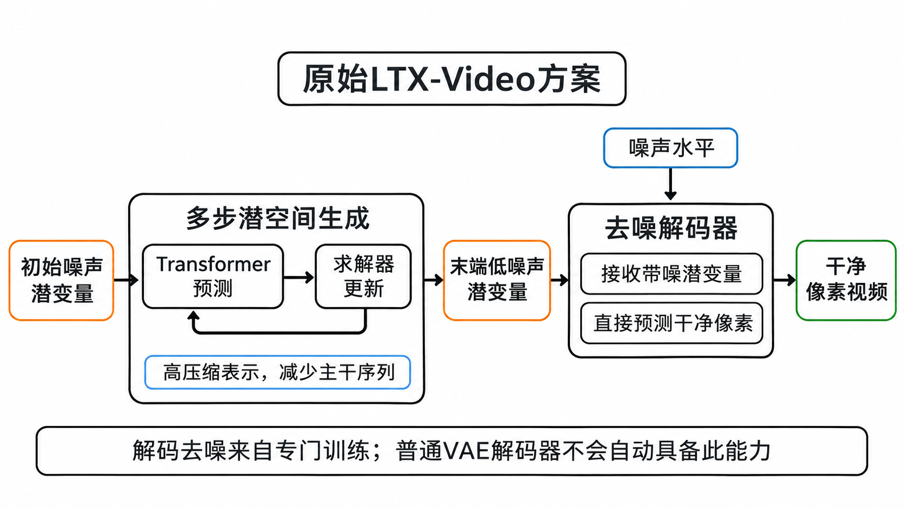
  <p>图3-10 LTX-Video 的潜空间生成与解码去噪分工</p>
</div>

**3、收益与代价怎样判断？**

高压缩降低主干的多步生成成本，解码器负责末端去噪和细节补充，减少对独立多步高分辨率生成模块的需求。解码器直接输出像素，不将输出反馈为潜变量反复去噪。

论文的对照实验显示，启用解码去噪后，生成结果更受内部用户研究的参与者偏好，改善在高运动视频中尤为明显。实际加速幅度仍应根据主干生成、VAE 解码和输出处理的总耗时判断，不能直接等同于 token 数量的缩减比例[20]。

> **面试速答**：原始 LTX-Video 使用高压缩 Video-VAE 缩短视频 token 序列，降低 Transformer 多步生成的成本；同时，专门训练解码器，使其根据带噪潜变量和噪声水平，在转换为像素时完成最后一步去噪。其核心思想是共同设计潜空间表示、生成主干与解码器，通过调整三者的分工平衡计算开销和输出细节。

延伸阅读：[LTX-Video 官方仓库](https://github.com/Lightricks/LTX-Video)

---

## <a id="q-4-3-7"></a>4.3.7 视频编辑技术路线：源视频利用、修改控制与跨帧一致性

> 本节讨论视频编辑如何利用源信息、限定修改并维持时间一致性。先比较主要路线与通用约束，再分析反演、注意力控制等机制及 VACE 的条件表示，最后通过时间戳编辑检查修改与保持要求。

### <a id="q-4-3-7-1"></a>4.3.7.1 面试问题：基于生成模型的视频编辑有哪些主要思路？它们如何利用源视频？

**难度评分：⭐⭐⭐⭐ (4/5)  |  考察频率：⭐⭐⭐⭐ (4/5)**

基于生成模型的视频编辑，需要利用源视频保留布局、外观或运动等信息，同时按要求修改指定内容。从生成能力的来源出发，可以先理解两种有代表性的思路：**复用图像生成模型并补充跨帧联系，以及利用视频生成模型学习条件式编辑。**

**1、复用图像生成模型，并建立跨帧联系**

这类方法利用图像模型已有的生成与编辑能力，再通过额外机制处理视频中的时间关系。

利用源视频时，需要处理两个问题：

- **怎样保留源内容？** 利用反演得到的生成状态、源特征或注意力信息，保留布局与外观。
- **怎样让修改跨帧延续？** 利用光流、扩散特征对应或跨帧注意力，关联不同帧中的对象与区域，使修改随对象运动持续。

例如，Video-P2P 结合视频反演与交叉注意力控制，在修改语义内容时保留源视频结构[21]；TokenFlow 则利用帧间扩散特征对应传播编辑结果，减少逐帧编辑产生的外观变化[22]。它们侧重不同机制，并非所有方法都需要同时执行这些步骤。

这类思路便于复用图像模型和已有编辑方法，但需要专门处理时间一致性。快速运动、遮挡和大形变可能破坏帧间对应，造成纹理闪烁、漏改或错误传播。*相关机制见[4.3.7.3](#q-4-3-7-3)。*

**2、在视频生成模型中建模编辑条件**

这类方法以视频生成模型为基础，将源视频、文本指令、时空掩码或参考图等编码为条件，参与视频生成过程。训练样本将源视频、编辑指令及目标结果对应起来，使模型学习哪些源信息应继续使用，哪些内容应按指令改变。

不同条件承担的作用需要区分：

- **源视频**提供已有内容、布局和运动等信息。
- **文本指令与参考图**描述目标变化，或提供期望的外观。
- **时空掩码**显式标明允许修改的位置和时间范围；并非所有方法都要求用户提供掩码。

VACE 是一个代表：它将文本、帧序列和掩码组织为统一条件，再把条件特征接入视频生成主干，从而支持参考生成、局部编辑及任务组合[23]。*具体设计见[4.3.7.4](#q-4-3-7-4)。*

这类方法可以直接根据源视频条件生成编辑结果，无须先执行显式反演；但人物身份、动作和非编辑区域是否保持，仍需按任务要求检查。

两种思路可以结合：图像模型能够加入时间模块，视频模型也可以使用反演或特征传播。比较具体方法时，应看源信息如何进入生成过程、修改范围如何控制，以及帧间一致性如何建立。

图3-11并列展示了两种思路及其对源视频的利用方式，两者可以组合使用。

<div align="center">
  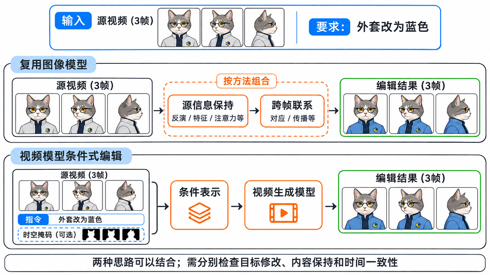
  <p>图3-11 视频编辑中两种可组合的源信息利用思路</p>
</div>

> **面试速答**：生成式视频编辑有两种有代表性的思路：一类复用图像生成模型，通过反演、注意力控制和帧间对应等机制利用源视频；另一类以视频生成模型为基础，将源视频与编辑要求组织为条件。两者可以组合，关键是解释源信息如何保留、修改如何受控，以及结果如何跨帧一致。

### <a id="q-4-3-7-2"></a>4.3.7.2 面试问题：视频编辑如何同时满足目标修改、源内容保持与时间一致性？

**难度评分：⭐⭐⭐⭐ (4/5)  |  考察频率：⭐⭐⭐⭐ (4/5)**

视频编辑需要改对目标、保留必要的源内容，并让两者在时间上持续成立。例如，将外套改为红色雨衣时，既要保持人物身份、动作与镜头，也要让新服装随运动自然变化。

**1、明确修改目标与范围**

说明修改哪个对象、什么属性，以及何时生效。文本描述目标变化，参考图提供期望外观，时空掩码限定修改范围；没有显式掩码时，则需由模型或定位模块确定对象与区域。

修改范围应随对象运动和可见性变化。人物转身、抬手或被遮挡时，沿用首帧的固定区域可能漏改服装或误改背景。

**2、利用源信息保留必要内容**

源视频条件、反演状态或源特征提供原有外观、布局和运动信息，*具体机制见[4.3.7.3](#q-4-3-7-3)。*

保持范围由任务决定。换装通常应保留人物身份、动作和镜头，但服装轮廓、阴影与遮挡可以相应调整；锁死所有非目标像素，可能造成不自然的边界和光影。

持续注入过多原服装特征，可能使雨衣难以生成；源内容约束不足，又可能误改人物、动作或背景。

**3、让修改与保持跨帧延续**

通过时空建模、跨帧注意力或特征对应与传播，关联不同帧中的人物及服装，使修改随运动延续。雨衣颜色和款式应稳定，形状、褶皱与可见区域则随动作变化；遮挡后重新出现时，也应保持正确身份与服装。

若遮挡后误关联到另一个人物，仅平滑画面无法纠正。**时间一致性也不要求相邻帧相同：** 正常运动、光照变化和切镜都可能改变画面。限定时间段的编辑还需检查区间两端及范围外内容，*具体见[4.3.7.5](#q-4-3-7-5)。*

> **面试速答**：通过指令、参考图和时空掩码等条件明确修改目标与范围，通过源视频条件或源特征保留必要内容，再利用时空建模与帧间对应维持整段一致性。三类要求相互影响：保持过强可能改不动，修改过强可能误改，跨帧联系不足则可能闪烁或漂移。因此，需要分别评价修改完成度、内容保持程度和时间一致性。

### <a id="q-4-3-7-3"></a>4.3.7.3 面试问题：扩散式视频编辑如何利用反演、注意力控制、时空掩码与特征传播？

**难度评分：⭐⭐⭐⭐ (4/5)  |  考察频率：⭐⭐⭐⭐ (4/5)**

这四类机制分别帮助模型利用源内容、控制修改和建立帧间联系，可以组合使用，但并非每种编辑方法都需要全部采用。

<p align="center">表3-7 视频扩散编辑中四类机制的作用与局限</p>

| 机制 | 主要作用 | 典型局限 |
| --- | --- | --- |
| 反演 | 寻找能够重建源视频的生成状态，为编辑提供起点 | 存在反演误差；重建准确不保证容易编辑 |
| 注意力控制 | 利用源视频与目标条件的注意力信息，引导修改并保持结构 | 控制过强可能改不动，过弱可能破坏源内容 |
| 时空掩码 | 显式表示允许修改的位置与时间范围 | 掩码可能错位，边界与遮挡处容易漏改或误改 |
| 特征传播 | 根据帧间对应传递编辑后的特征，减少外观闪烁 | 错误对应可能导致细节错位或伪影传播 |

**1、反演：为编辑寻找生成起点**

扩散模型通常从噪声出发生成视频。反演（inversion）则根据源视频，估计能让模型尽量重建它的噪声状态或生成轨迹。随后改变文本或其他条件，再从该状态运行生成过程，在保留部分源内容的基础上完成编辑。

**反演与重建是两个步骤：** 反演寻找生成状态，重建则从该状态运行生成过程，检查源视频能否复现。反演误差可能使人物、布局或运动失真，但重建准确也不保证修改成功，编辑范围仍需其他机制控制。

Video-P2P将视频反演与交叉注意力控制结合，平衡源内容重建与目标修改[21]。

**2、注意力控制：修改内容，保留必要结构**

注意力控制可以复用、替换或融合注意力信息。交叉注意力关联文本与视觉特征，引导目标内容变化；自注意力关联视觉位置，可帮助保持结构与帧间关系。

例如，将外套改为雨衣时，可以保留人物姿态和画面布局相关的信息，同时允许服装外观改变。FateZero在反演时保存注意力信息，再在编辑时融合，以保持源视频的结构与运动[24]。

保留过多原服装信息可能改不动，保留不足又可能误改人物或布局。另外，由文本交叉注意力推得的目标区域不能直接当作精确分割。

**3、时空掩码：限定修改的位置与时间**

掩码标明哪些帧、哪些区域允许修改。目标移动、形变或被遮挡时，掩码应随可见区域变化，不能简单复制首帧掩码。

作为输入条件时，掩码提示模型在哪里修改；用于区域融合时，可以决定哪些位置使用编辑后的特征或潜变量，哪些位置保留源信息。因此，有掩码不等于区域外像素必然不变。

**目标定位与掩码表示也不同：** 确定“修改哪个人”是目标定位，标出这个人在各帧中的具体区域才是掩码表示。掩码可以借助分割、跟踪等方法生成，也可以由用户提供或修正。

**4、特征传播：让修改随对象运动延续**

逐帧独立编辑容易产生颜色、纹理或形状差异。特征传播根据帧间对应，把编辑后的特征传到其他帧的相关位置。

TokenFlow利用源视频中的扩散特征建立帧间对应，再传播编辑特征，尽量延续原有布局与运动[22]。例如，人物从左侧移到右侧时，服装特征应传到对应的人物区域，而非下一帧的原坐标。

大位移、遮挡和镜头切换可能破坏对应关系，错误匹配也会使伪影传播到后续帧。

> **面试速答**：反演寻找可重建源视频的生成状态；注意力控制引导语义修改并保留必要结构；时空掩码明确允许修改的位置与时间；特征传播根据帧间对应延续编辑结果。四者可以组合使用，具体方法不一定全部采用。

### <a id="q-4-3-7-4"></a>4.3.7.4 面试问题：VACE 如何通过统一条件表示支持多种视频生成与编辑任务？

**难度评分：⭐⭐⭐⭐ (4/5)  |  考察频率：⭐⭐⭐ (3/5)**

VACE 将不同任务的输入组织为文本、帧序列和时空掩码，再把条件特征接入视频生成主干。统一的是条件组织方式，不同任务通过帧内容与掩码设置表达差异。下面讨论原始论文中的条件表示与 Context Adapter 方案。

**1、用统一输入格式表达任务差异**

论文提出视频条件单元（Video Condition Unit，VCU）：

```math
V=[T;F;M]
```

其中， $T$ 为文本， $F$ 为包含视频或参考图的帧序列， $M$ 为与帧序列在空间和时间上对齐的掩码。掩码值1表示需要生成或修改，0表示保持。方括号表示条件的组织方式，不表示三种输入未经编码就直接拼接。

不同任务的设置见表3-8。

<p align="center">表3-8 VACE 中不同任务的帧条件与掩码设置</p>

| 任务 | 帧序列提供什么 | 掩码如何设置 |
| --- | --- | --- |
| 文生视频 | 用零值帧表示待生成位置 | 待生成位置全为1 |
| 参考生成 | 参考图与待生成位置 | 参考图位置为0，待生成位置为1 |
| 局部编辑 | 源视频 | 修改区域为1，保持区域为0 |
| 条件视频转换 | 深度、姿态或源视频等条件 | 待生成区域可全部为1 |

参考图放在条件序列前部，配全0掩码，表示它作为保留的条件输入，不表示必须将其复制成输出视频的一帧。参考图会单独进行 VAE 编码，再沿时间维度接入条件序列；最终输出时不保留这些参考位置[23]。

**2、分开表示待修改与保持信息，再编码为条件特征**

论文根据掩码将帧序列拆为两部分：

```math
F_c=F\odot M,\qquad F_k=F\odot(1-M)
```

这里， $\odot$ 表示逐元素相乘，同一位置的掩码值作用于该像素的所有颜色通道。 $F_c$ 承载待修改或控制信息， $F_k$ 承载保持或参考信息。

例如，换装时，原服装所在区域进入待修改分支，人物面部、背景等保留区域进入保持分支，使两类内容以不同角色提供给模型。

待修改分支不等于被丢弃的信息。姿态或深度条件仍可在对应位置引导生成，即使掩码全部为1，这些控制信息也会保留在 $F_c$ 中。

两部分分别通过视频 VAE 编码；掩码经过形状调整与插值，与编码结果对齐到相同的时空网格。随后将两路潜变量与处理后的掩码沿通道拼接，通过条件嵌入层转换为条件 token[23]。

**3、通过条件分支影响主干生成**

Context Adapter（上下文适配器）从原始 DiT 中复制部分 Transformer 块，组成条件分支。新增的 Context Blocks（条件块）处理条件 token 与文本，再将输出加到对应主干层的特征中，使后续生成能够利用这些条件。

适配器训练时，原始 DiT 主干参数保持不变，只更新条件嵌入层和新增条件块。论文另提供全量微调方案，后者会同时更新主干参数[23]。

统一表示还可以组合任务。例如，将服装参考图、源视频和服装区域掩码放入同一条件单元，即可表达“参考指定服装，对源视频局部换装”：三者分别提供目标外观、原有内容和修改位置。

> **面试速答**：VACE 用文本、帧序列与时空掩码统一表达生成、参考和编辑任务，再根据掩码区分待修改与保持信息，编码为条件 token。Context Adapter 将条件分支输出加到视频生成主干中；适配器训练冻结主干，更新新增条件模块。通过组合参考图、源视频与掩码，同一种输入格式能够表达多种任务及其组合。

### <a id="q-4-3-7-5"></a>4.3.7.5 面试问题：指定时间段的视频编辑，如何控制修改范围并保持其他内容？

**难度评分：⭐⭐⭐ (3/5)  |  考察频率：⭐⭐⭐ (3/5)**

指定时间段的视频编辑，需要在正确的时间范围内完成目标修改，同时保留任务要求不变的内容，并处理好修改区间与前后视频的衔接。**时间戳限定了“什么时候改”，还需要明确“改什么”和“保留什么”。**

**1、区分生成时的时间安排与已有视频的定向编辑**

以 Seedance 2.5 的官方功能说明为例，可以区分两种时间控制能力：

- **生成时安排内容**：通过提示词规定某段时间发生的故事、画面视角、运镜或节奏。
- **针对已有视频定向修改**：修改指定片段中的角色、动作、声音或剧情。

前者是在生成过程中安排内容，后者还需要利用源视频并满足保持要求。本题讨论后者的通用要求；此处以官方功能说明为例，不据此推断模型内部实现[25]。

**2、同时明确时间范围、目标变化与保持要求**

例如，提出以下编辑要求：

> 视频第5—8秒是人物手持杯子的独立镜头。仅将这个镜头中的杯子改为蓝色，保持人物动作、镜头和音频不变，其他镜头保持原样。

其中包含四类约束：

<p align="center">表3-9 指定时间段编辑中的修改与保持约束</p>

| 约束 | 本例中的含义 |
| --- | --- |
| 时间范围 | 修改仅作用于第5—8秒的指定镜头 |
| 目标对象 | 指定人物手持的杯子 |
| 目标变化 | 杯子颜色改为蓝色 |
| 保持要求 | 人物动作、镜头和音频不变，其他镜头保持原样 |

时间范围与对象范围需要同时满足：只在正确时间修改，却改错杯子，同样不符合要求。

图3-12将本例的修改范围与保持要求对应到源视频时间轴，便于分别检查区间内、两端、区间外及音频。

<div align="center">
  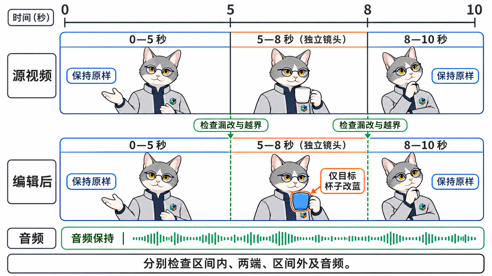
  <p>图3-12 指定时间段编辑中的修改范围与保持要求</p>
</div>

**3、分别检查区间内部、两端与外部，并单独核对音频**

以源视频时间轴为参照，确认输出时长和帧对应关系，再检查修改的起止时刻。若输出发生整体时间偏移，应先区分是视频时序改变，还是编辑作用范围偏移。

**（1）区间内部：修改是否完整且持续？**

检查正确的杯子是否在指定片段内变为蓝色，颜色是否随运动和遮挡保持稳定。只改对部分帧不足以证明修改完成。

**（2）区间两端：生效时间与衔接是否符合要求？**

检查指定镜头的开头或结尾是否有漏改帧、颜色闪变，以及修改是否影响相邻镜头。原有切镜位置和节奏应保持，不要求把正常镜头切换处理成平滑过渡。

**（3）区间外部：是否发生非预期变化？**

对照源视频检查其他镜头是否保持原样，包括人物、动作、背景和镜头内容，避免修改扩散到指定片段之外。

**（4）音频：修改与保持是否分别受控？**

本例只要求修改画面，应单独核对对白、背景音乐和音效是否被误改。若任务要求修改声音，则还需要检查声音变化是否发生在正确时间，以及音画同步是否受到影响。

*有关编辑与保持之间的取舍，可结合[4.3.7.2](#q-4-3-7-2)理解。*

> **面试速答**：指定时间段编辑需要同时明确时间范围、目标对象、目标变化和保持要求。评价时分别检查区间内是否持续完成修改、两端是否按时生效并合理衔接、区间外是否被误改，以及音频是否符合要求。

## <a id="q-4-3-summary"></a>总结

理解视频生成与编辑技术路线，需要把任务要求与模型设计联系起来：输入条件是什么，需要生成或修改什么，哪些内容必须保持，以及模型如何满足这些要求。

**1、不同路线体现了不同的能力来源与设计取舍**

图像模型视频化通过复用图像生成能力，再补充时间建模，降低视频生成的训练与适配成本；视频模型则通过视频数据训练与时空建模，学习外观、运动和时间关系。两种思路可以结合，不能简单理解为前后替代。

本章的代表方法分别展示了运动模块、分阶段训练、时空压缩、条件融合、后训练与推理加速等设计。比较它们时，应明确具体版本与公开依据，区分论文中的方法、开放模型的能力和产品提供的功能。

**2、生成与编辑共享部分技术，但任务要求不同**

生成任务根据条件构造内容；编辑任务还需要利用源视频，在完成指定修改的同时，保留任务要求不变的信息，并维持时间一致性。

反演、注意力控制、时空掩码与特征传播，可以帮助解决其中的不同问题；条件式编辑模型也可以通过训练学习如何利用源视频和参考信息。具体采用哪些机制，取决于模型与任务，不存在所有方法都必须遵循的固定流程。

**3、分析新方法时，重点检查五个方面**

| 分析方面 | 需要回答的问题 |
| --- | --- |
| 任务与条件 | 输入信息分别起什么作用？需要生成、修改和保持什么？ |
| 表示与主干 | 视频如何压缩和组织？模型如何建立时空联系、融合条件？ |
| 训练与适配 | 能力来自哪些预训练、任务训练或后训练？复用了哪些已有模型？ |
| 控制与一致性 | 条件是否被准确执行？对象、动作、场景及编辑范围是否符合要求？ |
| 效率与可复现性 | 质量与速度对应什么配置？代码、权重和技术细节公开到了什么程度？ |

判断一种方法的价值，应看它解决了什么问题、采用了什么机制，以及付出了什么代价。演示效果可以帮助认识能力，但不能替代对适用范围、失败情况和实现依据的分析。

当任务扩展到更长时间和多个镜头时，还需要处理跨片段主体保持、镜头组织与叙事连贯。下一章 [《长视频生成与多镜头叙事》](04_长视频生成与多镜头叙事.md) 将进一步讨论这些问题。

---

## <a id="q-4-3-references"></a>参考文献

[1] POLYAK A, ZOHAR A, BROWN A, et al. Movie Gen: a cast of media foundation models[J/OL]. arXiv preprint arXiv:2410.13720, 2024. https://arxiv.org/abs/2410.13720

[2] GUO Y, YANG C, RAO A, et al. AnimateDiff: animate your personalized text-to-image diffusion models without specific tuning[J/OL]. arXiv preprint arXiv:2307.04725, 2023. https://arxiv.org/abs/2307.04725

[3] BLATTMANN A, DOCKHORN T, KULAL S, et al. Stable Video Diffusion: scaling latent video diffusion models to large datasets[J/OL]. arXiv preprint arXiv:2311.15127, 2023. https://arxiv.org/abs/2311.15127

[4] ZHAO R, GU Y, WU J Z, et al. MotionDirector: motion customization of text-to-video diffusion models[J/OL]. arXiv preprint arXiv:2310.08465, 2023. https://arxiv.org/abs/2310.08465

[5] OPENAI. Video generation models as world simulators[EB/OL]. (2024-02-15)[2026-11-23]. https://openai.com/index/video-generation-models-as-world-simulators/

[6] GOOGLE. Fuel your creativity with new generative media models and tools[EB/OL]. [2026-11-23]. https://blog.google/innovation-and-ai/products/generative-media-models-io-2025/

[7] GOOGLE DEEPMIND. Veo: a text-to-video generation system[R/OL]. 2025[2026-11-23]. https://storage.googleapis.com/deepmind-media/veo/Veo-3-Tech-Report.pdf

[8] ZHENG Z, PENG X, LOU Y, et al. Open-Sora 2.0: training a commercial-level video generation model in \$200k[J/OL]. arXiv preprint arXiv:2503.09642, 2025. https://arxiv.org/abs/2503.09642

[9] KONG W, TIAN Q, ZHANG Z, et al. HunyuanVideo: a systematic framework for large video generative models[J/OL]. arXiv preprint arXiv:2412.03603, 2024. https://arxiv.org/abs/2412.03603

[10] TENCENT HUNYUAN. HunyuanVideo: Transformer backbone implementation[EB/OL]. [2026-11-23]. https://github.com/Tencent-Hunyuan/HunyuanVideo/blob/main/hyvideo/modules/models.py

[11] WAN TEAM. Wan2.2: introduction of Wan2.2[EB/OL]. [2026-11-23]. https://github.com/Wan-Video/Wan2.2#introduction-of-wan22

[12] WAN TEAM. Wan: open and advanced large-scale video generative models[J/OL]. arXiv preprint arXiv:2503.20314, 2025. https://arxiv.org/abs/2503.20314

[13] MA G, HUANG H, YAN K, et al. Step-Video-T2V technical report: the practice, challenges, and future of video foundation model[J/OL]. arXiv preprint arXiv:2502.10248, 2025. https://arxiv.org/abs/2502.10248

[14] STEP-VIDEO TEAM. Step-Video-TI2V technical report: a state-of-the-art text-driven image-to-video generation model[J/OL]. arXiv preprint arXiv:2503.11251, 2025. https://arxiv.org/abs/2503.11251

[15] YANG Z, TENG J, ZHENG W, et al. CogVideoX: text-to-video diffusion models with an expert Transformer[J/OL]. arXiv preprint arXiv:2408.06072, 2024. https://arxiv.org/abs/2408.06072

[16] MINIMAX. MiniMax-H3 model card[EB/OL]. [2026-11-23]. https://huggingface.co/MiniMaxAI/MiniMax-H3

[17] MINIMAX. 开放通用智能，MiniMax H3 正式开源[EB/OL]. [2026-11-23]. https://www.minimax.cn/news/minimax-h3-open-source

[18] BYTEDANCE SEED. Seedance 1.0: exploring the boundaries of video generation models[J/OL]. arXiv preprint arXiv:2506.09113, 2025. https://arxiv.org/abs/2506.09113

[19] KLING TEAM. Kling-Omni technical report[J/OL]. arXiv preprint arXiv:2512.16776, 2025. https://arxiv.org/abs/2512.16776

[20] HACOHEN Y, CHIPRUT N, BRAZOWSKI B, et al. LTX-Video: realtime video latent diffusion[J/OL]. arXiv preprint arXiv:2501.00103, 2024. https://arxiv.org/abs/2501.00103v1

[21] LIU S, ZHANG Y, LI W, et al. Video-P2P: video editing with cross-attention control[J/OL]. arXiv preprint arXiv:2303.04761, 2023. https://arxiv.org/abs/2303.04761

[22] GEYER M, BAR-TAL O, BAGON S, et al. TokenFlow: consistent diffusion features for consistent video editing[J/OL]. arXiv preprint arXiv:2307.10373, 2023. https://arxiv.org/abs/2307.10373

[23] JIANG Z, HAN Z, MAO C, et al. VACE: all-in-one video creation and editing[J/OL]. arXiv preprint arXiv:2503.07598, 2025. https://arxiv.org/abs/2503.07598

[24] QI C, CUN X, ZHANG Y, et al. FateZero: fusing attentions for zero-shot text-based video editing[J/OL]. arXiv preprint arXiv:2303.09535, 2023. https://arxiv.org/abs/2303.09535

[25] BYTEDANCE SEED. 一镜成片，随心参考｜Seedance 2.5 正式发布[EB/OL]. (2026-07-31)[2026-11-23]. https://seed.bytedance.com/zh/blog/one-take-creation-flexible-referencing-introducing-seedance-2-5
